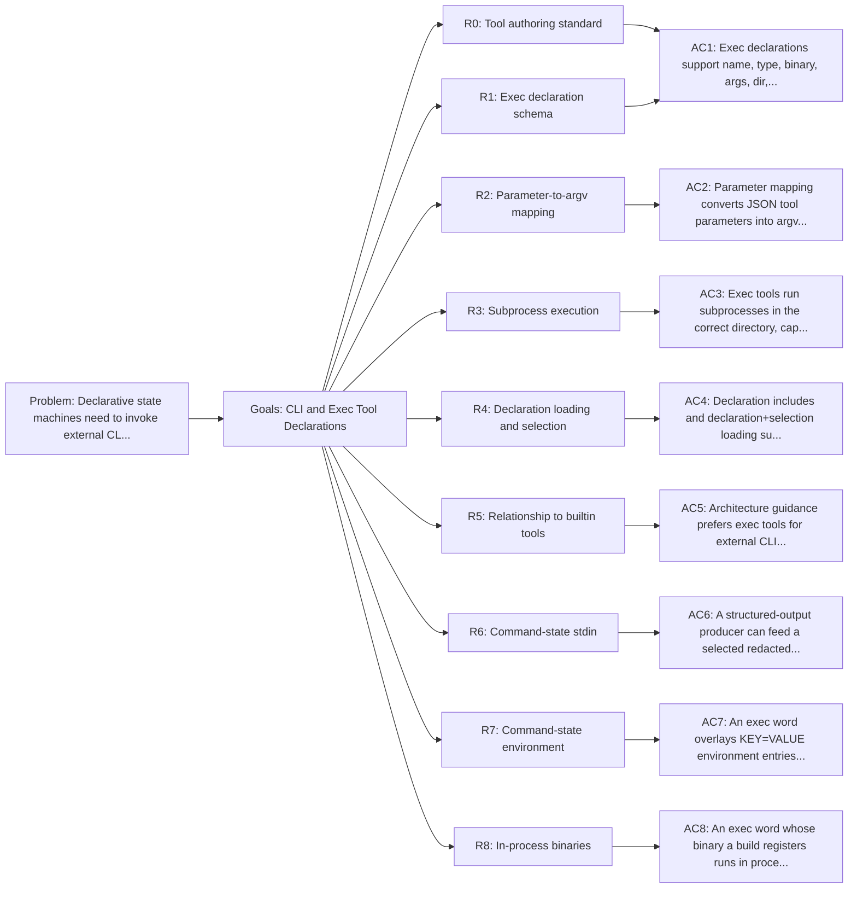

<!-- Copyright (c) 2026 Nokia -->
<!-- SPDX-License-Identifier: BSD-3-Clause -->

<!-- field: problem -->
## Problem

Declarative state machines need to invoke external CLIs without
embedding those CLI details in Go code. Exec tools provide this bridge:
YAML declares the binary, base arguments, parameter-to-argv mapping,
working directory behavior, child environment overlay, output limits, and
side effects. Without a focused contract for exec tools, each external
command risks becoming a bespoke builtin instead of a reusable
declarative capability.

ToolDef and parameter schema contracts live in internal/tools/catalog.
ExecBuilder and subprocess command construction live in internal/tools/exec,
and shared undo payload helpers live in internal/tools/undo.

<!-- field: goals -->
## Goals

- G1: Define the YAML contract for type: exec tool declarations.
- G2: Define JSON Schema parameter mapping extensions used to build argv.
- G3: Define subprocess execution, output capture, cancellation, and signal mapping.
- G4: Define declaration includes, declaration loading, and selection behavior for exec tools.
- G5: Clarify how exec tools differ from builtin tools.
- G6: Define the target package ownership for exec declarations, command construction, and undo helpers.
- G7: Let an exec parameter select a non-adjacent command-state value without changing adjacent previous-Result mapping.
- G8: Let one exec word consume a bounded, redacted output field from a prior labelled word over stdin without authoring a shell pipeline.
- G9: Let an exec word overlay child environment entries expanded from resolved command parameters.
- G10: Let a build of the agent serve an exec word's binary from code linked into it, with the declaration unchanged.

<!-- req: R0 -->
## R0 - Tool authoring standard

<!-- req: R0.1 -->
### R0.1

Exec tool declarations SHOULD follow cfg-tool-authoring-standard for vocabulary category, problem, goals, requirements, non-goals, output, side effects, reversibility, undo, errors, and relationships.

<!-- req: R0.2 -->
### R0.2

Exec tools SHOULD model one external CLI verb; multi-step workflows SHOULD be represented by machine.yaml transitions that use multiple exec or builtin tools.

<!-- req: R1 -->
## R1 - Exec declaration schema

<!-- req: R1.1 -->
### R1.1

An exec tool declaration SHALL set type to exec or omit type, since exec is the default.

<!-- req: R1.2 -->
### R1.2

An exec tool declaration SHALL provide name, the registry-visible tool name.

<!-- req: R1.3 -->
### R1.3

An exec tool declaration SHALL provide binary, the executable name or path.

<!-- req: R1.4 -->
### R1.4

An exec tool declaration MAY provide args, a base argument list prepended to every invocation.

<!-- req: R1.5 -->
### R1.5

An exec tool declaration MAY provide dir, a working-directory override relative to the agent workspace.

<!-- req: R1.6 -->
### R1.6

An exec tool declaration MAY provide precondition, output_cap, stdin_source, stdin_max_bytes, env, side_effects, visibility, description, and parameters.

<!-- req: R1.7 -->
### R1.7

An exec tool declaration MAY provide emits, the set of Result.Signal values the command wrapper can return.

<!-- req: R1.8 -->
### R1.8

An exec output contract MAY set mode to structured. Structured mode SHALL wrap the captured command result as a JSON object with output and exit_code fields. Omitted or raw mode SHALL preserve the existing raw Result.Output string.

<!-- req: R2 -->
## R2 - Parameter-to-argv mapping

<!-- req: R2.1 -->
### R2.1

Exec tool parameters SHALL be described with JSON Schema under parameters.properties.

<!-- req: R2.2 -->
### R2.2

The flag extension SHALL map a parameter value to a named CLI flag such as --path.

<!-- req: R2.3 -->
### R2.3

The positional extension SHALL append a parameter value as a positional argument.

<!-- req: R2.4 -->
### R2.4

The bool_flag extension SHALL be boolean; when true and the parameter value is true, a JSON true or the string "true", the flag value is appended without a following value. A false value, or an absent one without a true default, appends nothing.

<!-- req: R2.5 -->
### R2.5

The default extension SHALL provide a parameter value when the caller omits it.

<!-- req: R2.6 -->
### R2.6

CLI mapping extensions SHALL be stripped from the ToolSpec schema sent to LLMs.

<!-- req: R2.7 -->
### R2.7

The position extension SHALL order mapped arguments numerically; mappings without a position SHALL follow in stable parameter-name order.

<!-- req: R2.8 -->
### R2.8

A parameter property MAY declare source as one canonical $from(<label>).<dotted-path> selector (srd038 R2). When source is absent, ExecBuilder SHALL continue to read parameters.<name> from the immediately previous Result.

<!-- req: R2.9 -->
### R2.9

The source extension SHALL be stripped from the ToolSpec schema sent to LLMs with the other CLI mapping extensions.

<!-- req: R2.10 -->
### R2.10

Integer parameters mapped to argv SHALL retain their decimal representation so exec declarations such as list_files can enforce numeric CLI limits without changing the public JSON Schema type.

<!-- req: R2.11 -->
### R2.11

A resolved parameter that declares no flag, positional, or bool_flag extension SHALL contribute no argv entry. Its value SHALL remain available to non-argv consumers such as env expansion.

<!-- req: R2.12 -->
### R2.12

A parameter of type array SHALL map each element, a string or a number in decimal, to its own argv entry: the flag and the element for each element under the flag extension, the element alone under the positional extension, in the array's order. A lone string given for an array parameter SHALL map as an array of one, and an empty array SHALL contribute nothing.

<!-- req: R2.13 -->
### R2.13

A parameter present with a JSON type its mapping cannot take, an array or an object for a scalar parameter, an object or a boolean for an array parameter, SHALL fail the call with a ToolFailed result naming the parameter, the type it must be, and the type it got, whether or not the parameter is required. A null value SHALL count as absent. A missing required parameter SHALL fail with a result naming it as missing.

<!-- req: R3 -->
## R3 - Subprocess execution

<!-- req: R3.1 -->
### R3.1

ExecBuilder SHALL construct argv from base args plus mapped parameter values.

<!-- req: R3.2 -->
### R3.2

ExecBuilder SHALL run the command in the configured workspace directory or dir override.

<!-- req: R3.3 -->
### R3.3

ExecBuilder SHALL capture stdout, stderr, exit code, elapsed duration, and execution errors.

<!-- req: R3.4 -->
### R3.4

Successful exit SHALL map to ToolDone.

<!-- req: R3.5 -->
### R3.5

Non-zero exit or execution failure SHALL map to ToolFailed unless the failure prevents command construction, which SHALL map to CommandError.

<!-- req: R3.6 -->
### R3.6

Output SHALL be capped when output_cap is configured.

<!-- req: R3.7 -->
### R3.7

Parent context cancellation SHALL stop the subprocess.

<!-- req: R3.8 -->
### R3.8

Exec tools used as named machine actions SHOULD declare emits: [ToolDone, ToolFailed] unless they implement a more specific signal mapping.

<!-- req: R3.9 -->
### R3.9

ExecBuilder SHALL defer a source selector until the command receives its CommandStateView and SHALL resolve it before subprocess launch. An unresolved label or path SHALL emit CommandError with the selector cause preserved, and the subprocess SHALL NOT run with an empty substituted value.

<!-- req: R4 -->
## R4 - Declaration loading and selection

<!-- req: R4.1 -->
### R4.1

Tool declaration files MAY include other declaration files with file-level includes.

<!-- req: R4.2 -->
### R4.2

Included declarations SHALL load before the including file so local definitions can override shared definitions.

<!-- req: R4.3 -->
### R4.3

Production startup SHOULD use LoadToolDeclarations + LoadToolSelection + SelectTools.

<!-- req: R4.4 -->
### R4.4

Selected exec tools SHALL fail startup if the selected name is not declared.

<!-- req: R4.5 -->
### R4.5

A source value that is not a canonical $from(<label>).<dotted-path> selector SHALL fail declaration validation before a run.

<!-- req: R5 -->
## R5 - Relationship to builtin tools

<!-- req: R5.1 -->
### R5.1

Exec tools SHALL represent external process capabilities described entirely by YAML.

<!-- req: R5.2 -->
### R5.2

Builtin tools SHALL be used when behavior requires Go-owned state, in-process APIs, or custom command construction that cannot be represented as argv mapping.

<!-- req: R5.3 -->
### R5.3

A CLI SHOULD be modeled as an exec tool before introducing a bespoke builtin wrapper.

<!-- req: R5.4 -->
### R5.4

Agent subprogram invocation SHOULD use the agent CLI exec tool contract when possible.

<!-- req: R6 -->
## R6 - Command-state stdin

<!-- req: R6.1 -->
### R6.1

stdin_source MAY contain one canonical $from(<label>).<dotted-path> selector resolved through the injected CommandStateView and ResolveFromSelector before process launch.

<!-- req: R6.2 -->
### R6.2

The selected value SHALL be a non-empty string from the prior step's redacted output object. Missing labels, missing paths, empty values, non-string values, unavailable redacted output, and malformed selectors SHALL fail before subprocess launch with CommandError or declaration-validation failure as applicable.

<!-- req: R6.3 -->
### R6.3

stdin_max_bytes MAY declare a positive byte limit only when stdin_source is present. The implementation SHALL apply a finite default when omitted and SHALL reject, rather than truncate, input exceeding the effective limit before launch.

<!-- req: R6.4 -->
### R6.4

One exec word SHALL still launch exactly one declared binary and argv. stdin_source SHALL NOT invoke a shell or accept a pipeline authoring surface.

<!-- req: R6.5 -->
### R6.5

ExecCmd SHALL implement ContextCommand. Cancellation or timeout SHALL close the stdin pipe, terminate the process group, wait for the subprocess, and join the stdin writer before returning.

<!-- req: R6.6 -->
### R6.6

Resolved stdin bytes SHALL NOT be added to trace attributes, metric attributes, or exec receipts. CommandStateView receipt blindness SHALL keep prior receipts unaddressable.

<!-- req: R6.7 -->
### R6.7

Structured producer output and its redaction metadata SHALL remain selectable after checkpoint save/load. Existing argv-only declarations SHALL retain their prior execution and output behavior.

<!-- req: R7 -->
## R7 - Command-state environment

<!-- req: R7.1 -->
### R7.1

env MAY list KEY=VALUE strings. KEY SHALL match [A-Za-z_][A-Za-z0-9_]*. Each entry SHALL contain a KEY, an equals sign, and a non-empty VALUE. Omitted or empty env SHALL inherit the parent environment only.

<!-- req: R7.2 -->
### R7.2

A VALUE MAY contain "{{ params.NAME }}" tokens. ExecCmd SHALL expand those tokens from resolved exec parameters after source resolution and before subprocess launch. Env values SHALL NOT contain $from selectors; command-state threading uses the parameter source extension (R2.8).

<!-- req: R7.3 -->
### R7.3

Missing parameters, empty expanded values, malformed entries, unknown template tokens, and template names that are not declared parameters SHALL fail before launch with CommandError or declaration-validation failure as applicable. The subprocess SHALL NOT start.

<!-- req: R7.4 -->
### R7.4

ExecBuilder SHALL pass expanded entries as subprocess.Spec.Env. The subprocess layer SHALL append them to os.Environ so declared keys overlay inherited ones without replacing the rest of the parent environment.

<!-- req: R7.5 -->
### R7.5

Builtin ToolDefs SHALL NOT declare env. env SHALL require binary.

<!-- req: R7.6 -->
### R7.6

Resolved env values SHALL NOT be added to trace attributes, metric attributes, or exec receipts.

<!-- req: R7.7 -->
### R7.7

Existing argv-only and stdin-only declarations SHALL retain their prior execution and output behavior.

<!-- req: R8 -->
## R8 - In-process binaries

<!-- req: R8.1 -->
### R8.1

A build of the agent MAY register a runner under a binary name with pkg/inprocess. An exec tool whose binary has a registered runner SHALL call the runner with the args, working directory, and stdin a subprocess would have had, instead of starting a process.

<!-- req: R8.2 -->
### R8.2

An in-process run SHALL be reported as a subprocess's: its combined output and exit code SHALL map to ToolDone or ToolFailed, and output caps, shaping, receipts, and metrics SHALL apply unchanged.

<!-- req: R8.3 -->
### R8.3

In-process runs SHALL run one at a time, since a runner shares the process's working directory and globals. A declaration that overlays environment entries SHALL NOT run in process and SHALL emit CommandError.

<!-- req: R8.4 -->
### R8.4

A build that registers no runner SHALL run every exec tool as a subprocess, as before.

<!-- field: package_ownership -->
## Package ownership

<!-- field: status -->
### Status

planned

<!-- field: notes -->
### Notes

- Exec ToolDef schema and declaration selection move to internal/tools/catalog.
- ExecBuilder, ExecCmd, parameter extraction, argv construction, env expansion, precondition checks, output caps, and subprocess result mapping move to internal/tools/exec.
- Exec undo memento payload helpers use internal/tools/undo.
- internal/tools/stl exposes only thin aliases or wrappers during migration and is not the long-term exec implementation package.

<!-- field: declaration_layout -->
## Declaration layout

<!-- field: status -->
### Status

planned

<!-- field: shared_groups -->
### Shared groups

- tools/exec/go/
- tools/exec/workspace/
- tools/exec/git/
- tools/exec/issues/

<!-- field: compatibility_bundles -->
### Compatibility bundles

- tools/exec.yaml
- tools/exec/all.yaml

<!-- field: rules -->
### Rules

- Shared groups own reusable exec identity, argv mapping, output caps, side effects, undo, and emits.
- tools/exec.yaml remains a compatibility bundle while existing startup paths migrate.
- tools/exec/all.yaml is the planned explicit full exec bundle.
- Agent tools.yaml files keep selecting exec tools by name only.

<!-- field: non_goals -->
## Non-goals

- Defining every external command used by the repository.
- Defining builtin factory config validation; see srd022.
- Defining the agent CLI itself as a child tool; see srd021.
- Passing per-request values through a parent-written --request file.
- Replacing the subprocess overlay of declared env onto os.Environ.

<!-- field: acceptance_criteria -->
## Acceptance criteria

<!-- ac: AC1 -->
### AC1

Exec declarations support name, type, binary, args, dir, precondition, output_cap, optional command-state stdin, optional env overlay, raw or structured output, side_effects, visibility, description, parameters, and optional emits.

<!-- field: traces -->
#### Traces

- [R0.1](#r01)
- [R0.2](#r02)
- [R1.1](#r11)
- [R1.2](#r12)
- [R1.3](#r13)
- [R1.4](#r14)
- [R1.5](#r15)
- [R1.6](#r16)
- [R1.7](#r17)
- [R1.8](#r18)

<!-- ac: AC2 -->
### AC2

Parameter mapping converts JSON string, integer, boolean, and array tool parameters into deterministic argv using flag, positional, bool_flag, default, position, and optional command-state source extensions, an array element per flag occurrence while stripping those extensions from the LLM-visible schema. Omitting source preserves immediately previous Result mapping.

<!-- field: traces -->
#### Traces

- [R2.1](#r21)
- [R2.2](#r22)
- [R2.3](#r23)
- [R2.4](#r24)
- [R2.5](#r25)
- [R2.6](#r26)
- [R2.7](#r27)
- [R2.8](#r28)
- [R2.9](#r29)
- [R2.10](#r210)
- [R2.11](#r211)
- [R2.12](#r212)
- [R2.13](#r213)

<!-- ac: AC3 -->
### AC3

Exec tools run subprocesses in the correct directory, capture output/exit/duration, honor output caps and cancellation, map outcomes to ToolDone, ToolFailed, or CommandError, and can declare those signals in emits. A command-state source resolves after view injection and a broken source prevents subprocess launch with CommandError.

<!-- field: traces -->
#### Traces

- [R3.1](#r31)
- [R3.2](#r32)
- [R3.3](#r33)
- [R3.4](#r34)
- [R3.5](#r35)
- [R3.6](#r36)
- [R3.7](#r37)
- [R3.8](#r38)
- [R3.9](#r39)

<!-- ac: AC4 -->
### AC4

Declaration includes and declaration+selection loading support shared exec definitions with mode-local overrides, and malformed command-state sources fail validation before a run.

<!-- field: traces -->
#### Traces

- [R4.1](#r41)
- [R4.2](#r42)
- [R4.3](#r43)
- [R4.4](#r44)
- [R4.5](#r45)

<!-- ac: AC5 -->
### AC5

Architecture guidance prefers exec tools for external CLIs and builtin tools only for in-process behavior that cannot be represented declaratively.

<!-- field: traces -->
#### Traces

- [R5.1](#r51)
- [R5.2](#r52)
- [R5.3](#r53)
- [R5.4](#r54)

<!-- ac: AC6 -->
### AC6

A structured-output producer can feed a selected redacted output string to a separate consumer binary over bounded stdin; invalid input prevents launch, cancellation joins the child, persistence preserves safe selection, receipts remain isolated, and telemetry does not capture stdin.

<!-- field: traces -->
#### Traces

- [R1.8](#r18)
- [R6.1](#r61)
- [R6.2](#r62)
- [R6.3](#r63)
- [R6.4](#r64)
- [R6.5](#r65)
- [R6.6](#r66)
- [R6.7](#r67)

<!-- ac: AC7 -->
### AC7

An exec word overlays KEY=VALUE environment entries expanded from resolved parameters onto the inherited parent environment; invalid or unresolved env prevents launch; telemetry and receipts omit resolved env values; argv-only and stdin-only declarations stay unchanged.

<!-- field: traces -->
#### Traces

- [R1.6](#r16)
- [R7.1](#r71)
- [R7.2](#r72)
- [R7.3](#r73)
- [R7.4](#r74)
- [R7.5](#r75)
- [R7.6](#r76)
- [R7.7](#r77)

<!-- ac: AC8 -->
### AC8

An exec word whose binary a build registers runs in process with the args and directory a subprocess would have had, a zero exit is ToolDone and a non-zero exit ToolFailed with the runner's output, and an unregistered binary still runs as a subprocess.

<!-- field: traces -->
#### Traces

- [R8.1](#r81)
- [R8.2](#r82)
- [R8.3](#r83)
- [R8.4](#r84)

<!-- field: implementation -->
## Implementation

- tools/exec/ (current flat shared exec declarations)
- tools/exec/go/ (planned grouped declarations)
- tools/exec/workspace/ (planned grouped declarations)
- tools/exec/git/ (planned grouped declarations)
- tools/exec/issues/ (planned grouped declarations)
- tools/exec.yaml (compatibility bundle)
- tools/exec/all.yaml (planned compatibility bundle)
- internal/tools/catalog/ (planned ToolDef, declaration loading, and selection)
- internal/tools/exec/ (planned ExecBuilder and ExecCmd)
- pkg/inprocess/ (runners a build registers for in-process binaries)
- internal/tools/undo/ (planned shared undo payload helpers)

<!-- field: related_documents -->
## Related documents

- cfg-tool-authoring-standard

<!-- field: diagrams -->
## Diagrams

<!-- field: requirements_trace -->
### Requirements trace

