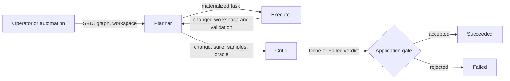
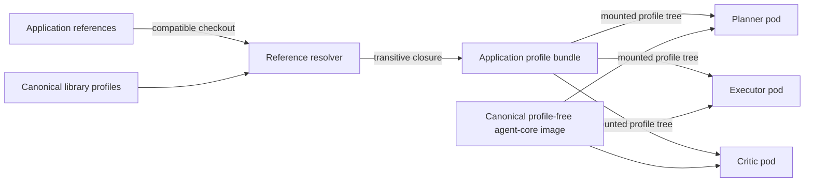

<!-- Copyright (c) 2026 Nokia -->
<!-- SPDX-License-Identifier: BSD-3-Clause -->

<!-- field: capability_classification -->
## Capability classification

<!-- field: ownership -->
### Ownership

composition-only

<!-- field: module_status -->
### Module status

implemented

<!-- field: composition_wrappers -->
### Composition wrappers

- planner
- executor
- critic
- applier

<!-- field: overview -->
## Overview

<!-- field: summary -->
### Summary

The coding agent composes three canonical applications/catalog agents.
The planner reads a requirement graph and SRD context, materializes a task,
and delegates it to the executor. The executor changes an isolated
workspace and returns validation evidence. The critic evaluates that
existing candidate with its declared oracle; its explicit verdict gates the
application outcome.

The application owns composition, packaging, deployment, and end-to-end
tests. Agent behavior remains profile-owned, and execution capability
remains agent-core-owned. At package time, the configured compatible
library checkout is snapshotted into a closed application profile tree and
its revision is recorded. At runtime, Kubernetes starts every agent from
one profile-free canonical agent image and mounts that tree. The executor's
build, lint, and test transitions require Go 1.26 and golangci-lint
v2.12.2; those binaries arrive as digest-pinned, read-only tool-donor
volumes mounted on the executor. The changed-workspace critic's independent
test oracle receives Go alone through its own read-only donor volume. The
shared image therefore stays profile-free and toolchain-free for every role.

<!-- field: coding_loop_diagram -->
### Coding loop diagram

<!-- field: packaging_diagram -->
### Packaging diagram

<!-- field: interfaces -->
## Interfaces

<!-- interface: coding request -->
### coding request

The application input names an SRD, requirement graph, mounted workspace,
planning model config, execution model config, and the canonical critic
changed-workspace mode with its declared oracle.

<!-- interface: planner-to-executor delegation -->
### planner-to-executor delegation

The planner passes a materialized task, workspace location, and model
selection to the canonical executor profile through child-profile
execution. No fake agent binary satisfies the application contract.

<!-- interface: executor result -->
### executor result

The executor returns a changed workspace, terminal status, tool and
validation results, and a traceable task summary to the planner.

<!-- interface: critic gate -->
### critic gate

The canonical changed-workspace critic receives the existing candidate
through its runtime directory binding, runs its declared oracle in place,
and writes critic-verdict.json. The application maps accepted to Succeeded
and rejected to Failed.

<!-- interface: packaged profile mount -->
### packaged profile mount

Each container starts the agent-core runtime with a profile selected from
the package-time closure mounted under `/profiles`. The image itself
contains no planner, executor, critic, or application profile.

<!-- field: components -->
## Components

<!-- component: planner -->
### planner

Traverse the requirement graph, assemble and parse a plan, materialize the
coding task, delegate to the executor, and record execution and validation
outcomes. The application references this profile; it does not fork it.

<!-- field: source -->
#### Source

applications/catalog/agents/planner/

<!-- field: library_requirement -->
#### Library requirement

applications/catalog/docs/specs/software-requirements/srd004-planner.md

<!-- component: executor -->
### executor

Receive the task and mounted workspace, invoke the model boundary,
dispatch filesystem and validation tools, and terminate only after
machine-declared validation. The application references this profile; it
does not fork it.

<!-- field: source -->
#### Source

applications/catalog/agents/executor/

<!-- field: library_requirement -->
#### Library requirement

applications/catalog/docs/specs/software-requirements/srd002-executor.md

<!-- component: critic -->
### critic

Evaluate the existing changed workspace, branch on the declared oracle
result, and emit the explicit accepted or rejected verdict that gates the
coding result. The benchmark/session mode remains available separately.
The application references these profiles; it does not fork them.

<!-- field: source -->
#### Source

applications/catalog/agents/critic/

<!-- field: library_requirement -->
#### Library requirement

applications/catalog/docs/specs/software-requirements/srd003-critic.md

<!-- component: application package -->
### application package

Select a checkout compatible with the declared library release, identify
its provenance, resolve direct references, collect the transitive
profile/config/declaration/tool closure, and emit a deterministic
self-contained application profile tree without modifying the runtime
image.

<!-- field: path -->
#### Path

agents/application.yaml, magefiles/profiles_closure.go, and magefiles/profiles_deployment.go

<!-- field: status -->
#### Status

implemented

<!-- component: Kubernetes deployment -->
### Kubernetes deployment

Run planner, executor, and critic as separate workloads, mount the
packaged profiles and workspace at declared paths, and expose only the
delegation and result interfaces required by the coding loop.

<!-- field: path -->
#### Path

helm/

<!-- field: status -->
#### Status

implemented

<!-- component: Persistent serving composition -->
### Persistent serving composition

Host truthful role request and lifecycle endpoints. The planner request
reuses canonical planner model and parsing words, invokes the executor and
critic through declared REST clients, and keeps filesystem authority in
the shared runtime directory rather than in request input.

<!-- field: path -->
#### Path

agents/

<!-- field: status -->
#### Status

implemented

<!-- component: applier -->
### applier

Actuate the coding chart on Kubernetes. An authorized operator or CI caller
submits a decided values-plane patch to the applier's apply endpoint; the
applier validates it against the chart's values.schema.json by a helm dry-run,
applies it with helm upgrade --reuse-values returning without waiting, verifies
the planner, executor, and critic Deployments via kubectl rollout status, and
rolls the release back on a verify stall while reporting an apply-command
failure as failed. The applier alone binds helm
and kubectl as exec tools; the serving roles carry none. This is an
application-owned agent, not a library reference. The coding application runs
no control plane, so the applier is a standalone actuator with no in-cluster
creator, orchestrator, or panel.

<!-- field: path -->
#### Path

agents/applier/

<!-- field: status -->
#### Status

implemented

<!-- field: library_requirement -->
#### Library requirement

docs/specs/software-requirements/srd006-applier.md

<!-- component: documentation -->
### documentation

Own the application vision, architecture, road map, coding-loop use case,
and staged integration test contract.

<!-- field: path -->
#### Path

docs/

<!-- field: design_decisions -->
## Design decisions

<!-- decision: 1 -->
### 1 - Reference canonical library agents

The application records references to planner, executor, and critic in
`applications/catalog`. It does not copy profiles, declarations, or SRDs.

<!-- field: benefits -->
#### Benefits

- Each agent has one canonical maintenance and conformance boundary.
- Library changes reach applications only when a new checkout closure is packaged.
- Application documents describe composition instead of restating family requirements.

<!-- decision: 2 -->
### 2 - Assemble profile closure at package time

`agents/application.yaml` uses the shared Release 14 schema, declares a
compatible catalog `v0.*` release, and names the four canonical roots plus
local planner, executor, critic, and applier deployment roots. `mage
package` snapshots the
configured checkout, resolves profile-local references from their
declaring YAML and `agents/...` references from the library root, then
preserves those paths in the per-application profile tree.
`/opt/agent-core/...` remains external. Unsafe, dangling, globbed, or
conflicting references fail. A non-release checkout records its revision
and compatible release separately instead of claiming release provenance.

<!-- field: benefits -->
#### Benefits

- Deployment has no runtime dependency on the source repository layout.
- Missing transitive assets fail packaging instead of a live workload.
- The package records the exact source revision used by every entry profile.

<!-- decision: 3 -->
### 3 - Run every agent from one profile-free image

One profile-free canonical agent image runs every agent workload:
planner, executor, critic, collector, applier, and any test double this
repository deploys. The image is the agent-core runtime contract; it is
not a toolchain superset. Profiles enter a workload only through the
packaged tree mounted at runtime, so the profile-free invariant holds
for every role.

The canonical executor declares Go and golangci-lint exec words. Those
binaries arrive as digest-pinned, read-only tool-donor volumes mounted
on the executor alone, following the applier CLI-donor pattern, rather
than by layering a second agent runtime image. A donor is a pinned
third-party init image, not an alternate agent image, and no other role
mounts the executor donor. The changed-workspace critic separately
declares a Go test oracle, so it receives Go alone through a distinct
read-only donor volume; it never receives the executor's linter, volume,
or PATH.

<!-- field: benefits -->
#### Benefits

- One agent image digest serves every role, so the composition model's one-image invariant holds without a per-role or per-test image.
- Runtime code and application profiles remain independently packaged.
- Role-specific tools stay scoped to the role that declares them.
- Application profile provenance is visible in its package.

<!-- decision: 4 -->
### 4 - Run one container per agent

Kubernetes runs planner, executor, and critic separately. Each selects one
profile from the same packaged closure and receives only its required
mounts and authority.

<!-- field: benefits -->
#### Benefits

- Workspace and subprocess authority can be scoped per role.
- Agent lifecycle and evidence remain attributable.
- The deployment mirrors the composition boundary.

<!-- decision: 5 -->
### 5 - Prove the loop in ordered stages

The integration suite first proves a live executor, then real planner
delegation to that executor, then the critic gate. Each stage names its
inputs and expected outputs and uses no fake agent binary.

<!-- field: benefits -->
#### Benefits

- A failure identifies the first broken application boundary.
- The suite proves real composition rather than paired stubs.
- Documentation gates implementation in specification-driven order.

<!-- decision: 6 -->
### 6 - Use existing configuration surfaces

The application introduces no template language. The current composition
needs no value override: planner and executor use canonical profile-local
LLM declarations and machine budgets, planner uses its existing child
profile config, and both critic modes are deterministic with no model,
REST target, or child profile. Future deployment-specific values may be
co-generated into profile-local declarations or explicit variants, but
the closure resolver copies referenced files without substitution.

<!-- field: benefits -->
#### Benefits

- Library profiles carry no coding-application values.
- Package contents have the same semantics as mounted profile contents.
- Later Helm and bundle consumers can reuse one closure contract.

<!-- decision: 7 -->
### 7 - Separate persistent hosts from finite role runs

Application-owned host profiles launch the role and lifecycle listeners
and await declared control events. machine_request starts finite canonical
executor and critic runs; the planner request profile owns only the remote
executor-then-critic sequence and reuses canonical planner LLM and parser
assets. All processes receive the same trusted runtime directory. The
caller supplies an opaque workspace identity for correlation, never a
filesystem root or transport authority.

<!-- field: benefits -->
#### Benefits

- Health describes a live agent-owned listener instead of a sidecar or sleep.
- Canonical batch profiles remain valid for local callers.
- Built-in REST trace propagation connects every remote role boundary.

<!-- decision: 8 -->
### 8 - Package one exact closure per serving role

Deployment packaging validates and resolves the shared application
manifest, stages application and canonical sources into one temporary
namespace, then publishes one closure per deployment entry. Each root
preserves /profiles paths and
receives only reachable assets. Sorted files are assigned sequentially to
900 KiB ConfigMap payload partitions; an individual oversized entry fails.
Deployment and role manifests record provenance, profile paths, partition
membership, and the profile-free image invariant.

<!-- field: benefits -->
#### Benefits

- Separate containers receive no unrelated role program.
- Resolver safety behavior has one implementation.
- Later Helm templates consume deterministic staging metadata.

<!-- decision: 9 -->
### 9 - Render Helm from prepared role manifests

`mage helmPrepare` regenerates #875 artifacts and stages them as the
chart's only profile source. Helm reads role manifests to render bounded
ConfigMaps, projected mounts, profile arguments, and role-scoped rollout
checksums. Every agent workload runs the one profile-free canonical agent
image and one trusted workspace claim; the executor additionally mounts
the digest-pinned Go and golangci-lint donor volumes its exec words
require. Fixed Services realize the serving contract;
OLLAMA_URL and OTLP flags select optional model and observability tiers.

<!-- field: benefits -->
#### Benefits

- Helm values cannot drift from resolved profile membership.
- A role profile edit rolls only that role.
- Runtime health and remote boundaries match tested application profiles.

<!-- decision: 10 -->
### 10 - Validate values, package integrity, and archive inventory

A strict draft-07 schema owns value shape and safe primitives; template
guards retain cross-field invariants under schema bypass. Role manifests
carry ordered-content checksums, and one strict validator compares
deployment metadata, role metadata, actual files, ConfigMap coverage,
encoded sizes, keys, and checksums before preparation and packaging.
`mage helm:package` validates the render matrix and requires every package
and chart file in the resulting archive before independently linting and
rendering it.

<!-- field: benefits -->
#### Benefits

- Invalid topology fails before Kubernetes output.
- Stale or tampered profile artifacts cannot enter a chart archive.
- Release artifacts do not depend on source-tree files after packaging.

<!-- decision: 11 -->
### 11 - Prove the packaged topology with an owned kind rig

`integration:helmSmoke` installs only the validated `.tgz` into a pinned
kind cluster through a temporary kubeconfig. It builds and loads one
commit-addressed canonical agent image, runs every agent workload from
it, mounts the executor's Go 1.26 and golangci-lint donors plus the
critic's separate Go-only oracle donor, deploys the
deterministic Ollama-compatible boundary as the canonical mock profile on
that same image, uses a kind-only RWX hostPath fixture, and
verifies role health, workspace mutation, critic verdict, and a connected
collector agent trace. Every agent and mock pod reports the same image ID.
Docker and Kubernetes probes classify infrastructure outages separately
from semantic failures; diagnostics and cleanup are bounded.

<!-- field: benefits -->
#### Benefits

- Static chart evidence is connected to real Kubernetes behavior.
- The application under test runs the same one-image topology as production.
- Model nondeterminism does not weaken role or trace assertions.
- A leftover cluster is replaced, every cluster is deleted after the run, and failures retain targeted evidence.

<!-- decision: 12 -->
### 12 - Separate the deciding caller from the actuating applier

The applier decides no deployment values. An authorized operator or CI caller
decides a values-plane patch and submits it to the applier's apply endpoint;
the applier validates it against the coding chart's values.schema.json, applies
it as a values-file rollout, verifies the planner, executor, and critic
Deployments, and rolls back on failure. Deployment authority is held by the
applier alone: it binds helm and kubectl as exec tools, and the planner,
executor, and critic profiles carry no deployment CLI. Authority is set by
declared, validated config, never by the actuation surface, which is
network-gated off the serving and collector pods. The applier runs the
profile-free agent-core image; a digest-pinned CLI donor copies helm and
kubectl into a read-only /opt/tools volume at pod start, so no image diverges
from the profile-free image invariant (GH-2222).
The coding application has no control plane, so the caller is external, not an
in-cluster creator, orchestrator, or panel.

<!-- field: benefits -->
#### Benefits

- The deciding operator and the actuating agent stay separable and auditable.
- Deployment CLIs never reach a serving role, so a running agent cannot actuate the cluster.
- The values-plane boundary keeps host, URL, method, and credential input off the apply path.

<!-- field: technology_choices -->
## Technology choices

| component | technology | purpose |
| --- | --- | --- |
| Agent runtime | the profile-free canonical agent-core image, shared by every role | Execute profile-declared machines and builtin tools without embedding application profiles in the image. The executor's Go build, v2 lint, and test commands run from digest-pinned, read-only tool-donor volumes mounted on the executor, so the shared image stays profile-free and toolchain-free. |
| Reusable agents | applications/catalog | Supply canonical planner, executor, and critic profiles and their library SRDs. |
| Application specification | YAML | Keep the vision, architecture, road map, use case, and test suite machine-readable and auditable. |
| Packaging | Compatible checkout snapshot and transitive closure | Produce a self-contained profile tree before deployment. |
| Deployment | Helm and Kubernetes | Run one container per agent with explicit mounts and boundaries. |
| Integration orchestration | Mage | Expose profile packaging, documentation audit, and staged coding-loop integration targets. |

<!-- field: project_structure -->
## Project structure

<!-- field: application -->
### Application

<!-- application_entry: agents/application.yaml -->
#### agents/application.yaml

<!-- field: role -->
##### Role

App-specific composition references, compatible release declaration, checkout provenance, runtime mount, and configuration-surface inventory.

<!-- application_entry: docs/ -->
#### docs/

<!-- field: role -->
##### Role

Application-level design and specification corpus.

<!-- application_entry: testdata/integration/ -->
#### testdata/integration/

<!-- field: role -->
##### Role

Planned coding-loop fixtures owned by this application.

<!-- application_entry: magefiles/profiles_closure.go -->
#### magefiles/profiles_closure.go

<!-- field: role -->
##### Role

Deterministic transitive library-profile closure assembly.

<!-- application_entry: magefiles/profiles_deployment.go -->
#### magefiles/profiles_deployment.go

<!-- field: role -->
##### Role

Role-specific closure publication and bounded ConfigMap partition metadata.

<!-- application_entry: agents/ -->
#### agents/

<!-- field: role -->
##### Role

Persistent planner, executor, and critic host profiles and remote request composition.

<!-- application_entry: agents/role-server/ -->
#### agents/role-server/

<!-- field: role -->
##### Role

Explicitly application-owned shared lifecycle wrapper used by the three serving actors.

<!-- application_entry: agents/applier/ -->
#### agents/applier/

<!-- field: role -->
##### Role

Standalone local composition wrapper over the canonical catalog applier.
Application-owned command bindings validate, apply, verify, and roll
back a decided coding-chart values patch.

<!-- application_entry: helm/ -->
#### helm/

<!-- field: role -->
##### Role

Implemented role-sharded deployment chart.

<!-- application_entry: magefiles/ -->
#### magefiles/

<!-- field: role -->
##### Role

Application packaging, audit, and staged integration targets.

<!-- field: library -->
### Library

| path | role |
| --- | --- |
| applications/catalog/agents/planner/ | Canonical planner profile. |
| applications/catalog/agents/executor/ | Canonical coding executor profile. |
| applications/catalog/agents/critic/ | Canonical critic profile. |
| applications/catalog/docs/specs/software-requirements/ | Canonical srd002, srd003, and srd004 family requirements. |

<!-- field: implementation_status -->
## Implementation status

<!-- field: current_focus -->
### Current focus

The application documentation, portable integration fixtures, live executor,
real planner delegation, canonical critic verdict gate, application
reference manifest, role-specific profile closure packaging, persistent
serving contract, core Helm topology, strict values, packaged-chart
validation, bounded kind deployment proof, and the canonical persistent
application on da-platform are implemented.

<!-- field: progress -->
### Progress

| implemented |
| --- |
| The planner -> executor -> critic coding loop and three-stage integration contract. |
| The reference-not-fork and package-time closure decisions, including deterministic checkout provenance and all four entry profiles. |
| One profile-free canonical agent image for every agent role (GH-2494), with the executor's Go and golangci-lint and the critic's Go-only oracle delivered as role-minimal, digest-pinned read-only tool donors rather than a second runtime image. |
| The one-container-per-agent deployment decision. |
| Live executor, real planner delegation, and changed-workspace critic gate targets using the real built binary and canonical profiles. |
| Persistent planner, executor, and critic serving profiles with lifecycle health, shared-workspace handoff, remote sequencing, and connected W3C traces. |
| Deterministic planner, executor, and critic deployment closures with provenance, exact reachable assets, and ConfigMap partition metadata. |
| Core Helm resources for role workloads and Services, shared workspace, truthful probes, model selection, and collector agent tracing. |
| Strict schema and semantic guards, profile package integrity, render matrix, and self-contained Helm archive validation. |
| Packaged-chart kind smoke with deterministic model boundary, RWX fixture, real role health, workspace/verdict proof, connected trace, infrastructure classification, diagnostics, and cleanup. |
| apprig app:up\|status\|verify\|diagnose\|down in app-coding-agent, with shared Traefik, an application bucket, persistent collector WAL, concurrent operation beside Agent Architecture, and retained query history across down/redeploy (GH-2483). |

<!-- field: related_documents -->
## Related documents

| doc | purpose |
| --- | --- |
| docs/VISION.md | Application goals, scope, and success criteria. |
| docs/road-map.md | Release status and sequencing. |
| docs/specs/use-cases/rel01.0-uc001-coding-loop.md | End-to-end planner, executor, and critic flow. |
| docs/specs/test-suites/test-rel01.0-coding-loop.md | Inputs and expected outputs for the three integration stages. |
| ../catalog/docs/specs/software-requirements/srd002-executor.md | Canonical executor family contract. |
| ../catalog/docs/specs/software-requirements/srd003-critic.md | Canonical critic family contract. |
| ../catalog/docs/specs/software-requirements/srd004-planner.md | Canonical planner family contract. |
