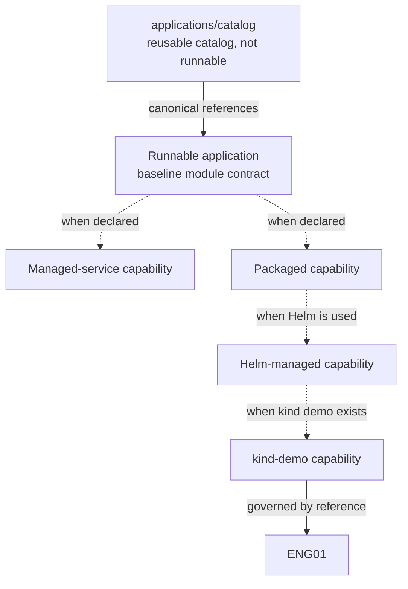
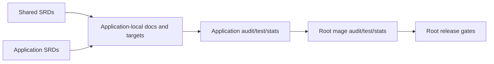
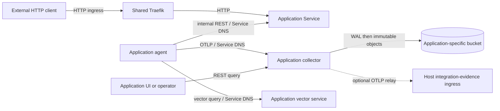

<!-- Copyright (c) 2026 Nokia -->
<!-- SPDX-License-Identifier: BSD-3-Clause -->

<!-- field: overview -->
## Overview

<!-- field: summary -->
### Summary

applications/ contains runnable modules and one reusable catalog module.
Runnable modules own executable composition, application-specific
configuration, end-to-end evidence, and operator-facing artifacts. The
catalog owns canonical reusable declarative blocks and their conformance.
agent-core owns runtime execution.

Baseline governance applies to each runnable module. Managed-service,
packaging, Helm, and kind-demo layers apply only when an application
declares the matching capability and provides structural evidence.

<!-- field: capability_diagram -->
### Capability diagram

<!-- field: governance_flow -->
### Governance flow

<!-- field: persistent_platform_flow -->
### Persistent platform flow

Traefik owns external HTTP only. Internal REST, OTLP, object storage, and
vector queries use their declared service or provider endpoints. The
application collector is the query authority for its bucket; retained
objects alone are not a live query service.

<!-- field: interfaces -->
## Interfaces

<!-- interface: root Mage orchestration -->
### root Mage orchestration

magefiles/build.go classifies platform submodules, runnable application
modules, and audit-only application modules. Root audit, test, stats, and
release code dispatch through those classifications.

<!-- interface: canonical catalog reference -->
### canonical catalog reference

A runnable application names canonical paths under applications/catalog,
pins or records compatibility when packaging requires it, and preserves
one canonical implementation owner.

<!-- interface: application-local Mage surface -->
### application-local Mage surface

Every runnable module exposes audit. A module with Go tests exposes those
tests to root mage test. A module that participates in repository metrics
exposes stats. Optional package, Helm, integration, doctor, and demo verbs
exist only for the capabilities that need them.

<!-- interface: shared application specifications -->
### shared application specifications

applications/docs defines baseline and capability-dependent obligations.
Application-local architecture and SRDs cite requirement IDs here and add
only business behavior, topology, or stricter local policy.

<!-- interface: normalized composition manifest -->
### normalized composition manifest

applications/<application>/agents/application.yaml is the target
composition authority for runnable and audit-only applications. It names
direct catalog and local roots, runtime paths, compatibility, applicable
deployment and UI entries, module and ownership status, capabilities, and
evidence. Package, Helm, stats, and audit code consume it instead of
maintaining another root inventory.

<!-- interface: role realization binding -->
### role realization binding

The shared agent-role-realizations semantic model treats canonical roles
as interfaces or traits and profiles as concrete realizations. Actors may
bind many roles, roles may be repeated across actors, and wrappers or
configuration variants inherit bindings without redefining roles.

<!-- interface: ENG01 kind rig -->
### ENG01 kind rig

docs/engineering/eng01-kind-test-demo-rig.md governs an application that
claims kind_demo. This architecture does not copy its toolchain, cluster,
image, network, observability, evidence, or verb requirements.

<!-- interface: persistent application platform -->
### persistent application platform

One `da-platform` supplies shared Traefik, object storage,
metrics-server, and storage provisioning. Each manifest-derived
application owns one stable namespace, release, collector gateway,
application-specific bucket identity, and lifecycle boundary. ENG08
realizes the same contract on GCP.

<!-- interface: reusable application rig -->
### reusable application rig

The root Mage module publishes `magefiles/apprig`. It consumes validated
manifest and platform bindings and implements
`app:up|status|down|diagnose|purge`. First-party and downstream modules
expose thin verbs and retain application-specific values and assertions.

<!-- field: components -->
## Components

<!-- component: shared application contract -->
### shared application contract

Define capability vocabulary, baseline module requirements, optional
managed-service requirements, traceability, and conformance evidence.

<!-- field: path -->
#### Path

applications/docs/

<!-- component: reusable application catalog -->
### reusable application catalog

Own canonical reusable declarative tool and agent blocks, family SRDs,
conformance, and release provenance. It is a reusable catalog module and
never enters the runnable application list.

<!-- field: path -->
#### Path

applications/catalog/

<!-- component: runnable application module -->
### runnable application module

Own executable composition, app-specific configuration, local docs,
end-to-end evidence, and every artifact implied by declared capabilities.

<!-- field: path -->
#### Path

applications/<application>/

<!-- component: root orchestrator -->
### root orchestrator

Enumerate participating modules and dispatch root audit, test, stats, and
release gates. Aggregate only canonical agent implementations into the
repository agent total.

<!-- field: path -->
#### Path

magefiles/

<!-- component: application-local architecture -->
### application-local architecture

Declare capability classes, composition, interfaces, and evidence paths.
Cite shared SRDs and define application-specific design without copying
this contract.

<!-- field: path -->
#### Path

applications/<application>/docs/ARCHITECTURE.md

<!-- component: application-local requirements -->
### application-local requirements

Define app-specific behavior and acceptance evidence. Shared lifecycle or
module obligations remain references to srd001 and applicable srd002
requirement groups.

<!-- field: path -->
#### Path

applications/<application>/docs/specs/software-requirements/

<!-- component: role realization authority -->
### role realization authority

Pin canonical role and sub-role IDs, classify every shipped profile, bind
actors to roles, define wrapper inheritance and naming grammar, and record
incompatible canonical-name collisions for migration.

<!-- field: path -->
#### Path

applications/docs/specs/semantic-models/agent-role-realizations.md

<!-- component: application composition authority -->
### application composition authority

Declare schema and application identity, ownership and module status,
capability statuses, direct catalog and local profile roots, runtime
paths, catalog compatibility, deployment entries, UI assets, and evidence.
Audit-only manifests may declare planned roots but cannot use them as
executable evidence.

<!-- field: path -->
#### Path

applications/<application>/agents/application.yaml

<!-- component: application-owned actor -->
### application-owned actor

Own one local production actor or thin wrapper and its primary or
operation-prefixed profiles, machines, name-only tool selections, ToolDef
declarations, REST definitions, request variants, and actor-served UI.
Canonical reusable implementations remain under applications/catalog/agents/.

<!-- field: path -->
#### Path

applications/<application>/agents/<actor>/

<!-- component: application user interface -->
### application user interface

Keep actor-served UI beside its serving actor and use the application-level
root only when no actor owns the surface. Declare source, generated dist,
REST serving definition, runtime destination, and canonical shared-token
consumption in the composition manifest. No UI path is required when the
application ships no UI.

<!-- field: path -->
#### Path

applications/<application>/agents/<actor>/ui/ or applications/<application>/ui/

<!-- component: shared UI kit -->
### shared UI kit

Own the npm package @declarative-agents/ui-kit: design tokens, the
injectable client, contract fixtures, the generic shell, shared hooks,
and the observability panels. Applications compose it with their domain
panels at build time from ui.yaml (srd004).

<!-- field: path -->
#### Path

applications/ui-kit/

<!-- component: manifest-derived package resolver -->
### manifest-derived package resolver

For packaged applications, traverse all reachable profile, machine, tool,
declaration, REST, child-profile, configuration, and declared UI assets
from manifest roots. Emit deterministic checksummed inventories and
compatibility-separated source provenance for Helm and release consumers.
Generated inventories are outputs, not composition authorities.

<!-- field: path -->
#### Path

applications/<application>/magefiles/

<!-- component: application README and status surface -->
### application README and status surface

Expose the common purpose, status, composition, capability, ownership,
entry-point, verification, and documentation sections. Keep baseline and
optional capability statuses independent and align audit_only or runnable
status with root Mage classification.

<!-- field: path -->
#### Path

applications/<application>/README.md

<!-- component: persistent platform services -->
### persistent platform services

Bootstrap or reconnect shared ingress, object-storage endpoint,
metrics-server, storage provisioning, and cloud identity adapters.
Platform down preserves retained data; local platform reset is the
explicit destructive path.

<!-- field: path -->
#### Path

magefiles/kindrig/ and magefiles/gcprig/

<!-- component: application lifecycle runner -->
### application lifecycle runner

Resolve one application manifest into release, namespace, route,
collector, and bucket bindings; run lifecycle and evidence mechanics; and
leave application behavior and assertions with the caller.

<!-- field: path -->
#### Path

magefiles/apprig/

<!-- component: application collector gateway -->
### application collector gateway

Accept application OTLP, record immutable object identity and upload
state in a local WAL, persist versioned trace and metric objects, serve
application-scoped queries, and optionally relay OTLP.

<!-- field: path -->
#### Path

applications/catalog/agents/collector/

<!-- field: design_decisions -->
## Design decisions

<!-- decision: 1 -->
### 1 - Baseline and capabilities are separate

runnable_module is the only universal application capability. The
managed_service, packaged, helm_managed, and kind_demo capabilities add
requirements only when declared. A requirement and its acceptance
criterion always state applicability.

<!-- field: benefits -->
#### Benefits

- A local or finite composition is not forced to ship a service or chart.
- Reviewers can test only the surfaces an application claims.
- New deployment technologies can add capabilities without weakening the baseline.

<!-- decision: 2 -->
### 2 - Catalog and applications have different module roles

applications/catalog is a reusable catalog module. Runnable applications
consume canonical members by reference and own composition. Composition-
only applications report reuse without an agents section, while
applications that own local agents report only those implementations.

<!-- field: benefits -->
#### Benefits

- Canonical behavior has one maintenance owner.
- Root stats do not count a referenced agent twice.
- Repository layout communicates ownership.

<!-- decision: 3 -->
### 3 - Root orchestration is executable membership evidence

A runnable application appears in applicationModules when it supplies
audit, tests, and stats, or in auditOnlyApplicationModules while only its
documentation gate exists. Root tests pin paths, gate participation, and
test/stats dispatch. Release-relevant runnable modules enter release tags
through releaseModules.

<!-- field: benefits -->
#### Benefits

- A new application cannot rely on an unverified README claim.
- Root gates cover the same stable module paths.
- Transitional documentation work has an explicit audit-only state.

<!-- decision: 4 -->
### 4 - Local documents extend instead of copy

Application architecture declares its capabilities and cites srd001 plus
applicable srd002 groups. Local SRDs define business behavior, stricter
constraints, and app-owned evidence. They do not reproduce shared
lifecycle, Mage, catalog, or ENG01 text.

<!-- field: benefits -->
#### Benefits

- Shared corrections have one source.
- Local requirements remain readable and specific.
- Applicability remains visible at each trace edge.

<!-- decision: 5 -->
### 5 - ENG01 remains capability-gated

kind_demo applications implement and cite ENG01. Applications without a
kind/Helm demo have no ENG01 obligation. This contract names the reference
and evidence boundary but does not duplicate the rig.

<!-- field: benefits -->
#### Benefits

- The kind contract cannot drift between documents.
- Non-Kubernetes applications retain a small baseline.
- kind demos use one operator vocabulary.

<!-- decision: 6 -->
### 6 - Roles and realizations are separate

A canonical role is a semantic interface or trait, not a unique deployed
agent. A profile is a concrete realization or a descriptive multi-role
actor. An actor may bind several roles and a role may be realized by many
actors. Request, session, server, workspace, model, and packaging forms
refine a realization; they do not create roles or sub-roles.

Wrappers inherit the canonical realization they select while retaining
application ownership of endpoints, deployment, and configuration.
Fixtures, mocks, human interfaces, and infrastructure adapters are
classified explicitly and excluded from role-coverage counts.

<!-- field: boundaries -->
#### Boundaries

<!-- field: role -->
##### Role

Stable reference responsibility with canonical role and sub-role IDs.

<!-- field: realization -->
##### Realization

Configured program binding roles in a domain and execution scope.

<!-- field: actor -->
##### Actor

Runtime identity that may bind one or many roles.

<!-- field: wrapper -->
##### Wrapper

Application or serving profile inheriting a canonical realization.

<!-- field: fixture -->
##### Fixture

Test-only profile or data excluded from production role coverage.

<!-- field: adapter -->
##### Adapter

Infrastructure or protocol boundary excluded from role coverage unless separately justified.

<!-- field: benefits -->
#### Benefits

- Repeated Critic implementations do not redefine Critic.
- Application actor names remain descriptive when several roles are bound.
- Deployment and model variants stay distinguishable from semantic specialization.
- Canonical-name collisions become explicit migrations instead of taxonomy changes.

<!-- decision: 7 -->
### 7 - One manifest owns composition

agents/application.yaml is the normalized authority for direct catalog and
local roots, stable runtime paths, compatibility, deployment entries, UI
assets, capabilities, ownership, and status. Build code, Helm values,
README prose, and generated package manifests may consume or explain this
declaration but cannot add another direct root.

<!-- field: benefits -->
#### Benefits

- Reviewers can determine the composition without reconstructing build code.
- Package, deployment, audit, and status checks share one input.
- Duplicate runtime paths and stale roots fail at one boundary.

<!-- decision: 8 -->
### 8 - Directory obligations follow capabilities

agents/application.yaml and the documentation/audit core apply to runnable
and audit-only modules. Actor, service, package, Helm, kind, request, and
UI directories exist only when their surfaces exist. A composition-only
module may have no local actor directory, and an audit-only module may
declare planned roots without creating executable stubs.

<!-- field: benefits -->
#### Benefits

- Small and documentation-first applications avoid false conformance.
- Missing optional surfaces remain not applicable instead of passing no-ops.
- Documentation-first applications can enter audit-only without claiming a runtime.

<!-- decision: 9 -->
### 9 - Operation prefixes align program files

profile.yaml, machine.yaml, tools.yaml, declarations.yaml, and rest.yaml
are primary names. A distinct operation uses one lower-kebab prefix across
<operation>-profile.yaml, <operation>-machine.yaml,
<operation>-tools.yaml, <operation>-declarations.yaml, and
<operation>-rest.yaml as needed. request is the reserved prefix for a
served request variant. tools files select names; declarations files own
ToolDefs. A variant does not require every possible file.

<!-- field: benefits -->
#### Benefits

- Related files are discoverable by name.
- Tool selection and ToolDef authority remain distinct.
- Optional request and REST surfaces do not create empty files.

<!-- decision: 10 -->
### 10 - Packages derive from declared roots

A packaged application starts closure traversal from executable manifest
roots and deployment entries only. The resolver traverses every reachable
program and declared UI asset, records compatibility separately from
actual catalog and application revisions, and emits the only package
inventory Helm consumes.

<!-- field: benefits -->
#### Benefits

- A profile cannot enter a chart through an unreviewed second list.
- Provenance identifies both compatibility and actual source.
- Generated inventory drift is detectable before publication.

<!-- decision: 11 -->
### 11 - Reuse must be demonstrated and consumed

Application assets move to the catalog only when independently useful or
consumed by at least two applications. Promotion migrates every consumer
and removes copies while local bindings remain application-owned. A UI
claims shared design tokens only when its build imports the canonical
kit source (applications/ui-kit/src/tokens.css) or a deterministic generated token block is protected by a
byte-for-byte drift test.

<!-- field: benefits -->
#### Benefits

- Speculative abstractions do not widen the catalog.
- Promoted behavior retains one owner and complete consumer migration.
- Shared-token labels correspond to actual values, not visual similarity.

<!-- decision: 12 -->
### 12 - Status is evidence and capability specific

planned, audit_only, partial, dependency_gated, implemented, and
not_applicable form the normalized conformance vocabulary. audit_only
requires a manifest, local audit, and root audit-only registration but
claims no runnable composition. partial and dependency_gated name missing
evidence; implemented names executable evidence. Each optional capability
is classified independently.

<!-- field: benefits -->
#### Benefits

- An implemented baseline does not overstate deployment maturity.
- Root orchestration and human-facing status can be compared mechanically.
- Transitional documentation has an exact, non-runnable state.

<!-- decision: 13 -->
### 13 - Panels bind to a closed presentation contract

Shared panels read only the endpoints srd004 R1 lists, reach other agents
only through /monitor-proxy, and perform I/O only through one injectable
client. An application bundle is composed at build time from ui.yaml, kit
panels, and its domain panels. Design tokens and shared panels live once
in applications/ui-kit; external repositories pin its release tarball.

<!-- field: benefits -->
#### Benefits

- Shared panels cannot drift with one application's backend.
- ui.yaml is the composition input rather than a checked copy of the routes.
- The same bundle runs same-origin or under a shell with remote base URLs.

<!-- decision: 14 -->
### 14 - Platform, application compute, and retained data have separate owners

Platform lifecycle owns shared compute. Each application lifecycle owns
one manifest-derived release and namespace. Retention authority owns one
application-specific bucket and permits deletion only through explicit
`app:purge`; local platform data deletion requires `platform:reset`.

<!-- field: benefits -->
#### Benefits

- Ordinary shutdown cannot silently become data deletion.
- Two applications can be operated independently on one platform.
- Diagnosis can identify the authority responsible for a failed boundary.

<!-- decision: 15 -->
### 15 - The application collector is the retained-history query authority

Each application keeps its collector gateway. The collector writes WAL
state before immutable object upload and serves queries scoped to its
application bucket. When `app:down` removes the collector, objects remain
but no live query API remains; redeployment restores access. There is no
permanent global query service in this release.

<!-- field: benefits -->
#### Benefits

- Retention survives compute without over-claiming availability.
- Query authorization and application identity remain co-located.
- A later global index requires an explicit new contract.

<!-- decision: 16 -->
### 16 - One shared object service contains application-specific buckets

Local fake GCS and cloud object storage expose one provider endpoint, but
every application receives its own bucket. Cloud workload identity and
bucket IAM enforce isolation. Local fake GCS proves declared
configuration and lifecycle separation only.

<!-- field: benefits -->
#### Benefits

- Shared infrastructure does not erase tenant identity.
- Local and cloud use identical collector declarations.
- The local threat claim stays within what fake GCS can enforce.

<!-- decision: 17 -->
### 17 - Protocol paths do not collapse into ingress

Shared Traefik handles external HTTP. Internal REST and OTLP use
application Service DNS. Collectors reach object storage directly, and
vector clients reach their declared vector service directly.

<!-- field: benefits -->
#### Benefits

- Routing, failure, and authorization boundaries remain visible.
- Internal telemetry does not depend on public ingress.
- Tests can attribute each path independently.

<!-- decision: 18 -->
### 18 - One reusable package owns application lifecycle mechanics

`magefiles/apprig` consumes the normalized application manifest and
platform adapters. First-party and downstream modules import it and expose
thin verbs. Application-specific values and assertions remain local and
no second composition inventory is introduced.

<!-- field: benefits -->
#### Benefits

- Lifecycle fixes have one owner.
- Downstream applications can pin a release instead of copying code.
- The manifest remains the composition authority.

<!-- decision: 19 -->
### 19 - Vector storage remains application-owned

da-platform does not provide a shared vector engine in Release 19.
Applications retain their own vector store, collection, corpus,
embedding identity, retrieval, ranking, retention, backup, and purge
authority. Collection or namespace naming is never presented as
authenticated tenant isolation. A future shared service requires measured
multi-application demand plus workload identity, authorization, quotas,
embedding compatibility, lifecycle, and backup contracts.

<!-- field: evidence -->
#### Evidence

applications/docs/specs/audits/tenant-isolated-vector-storage-register.md

<!-- field: benefits -->
#### Benefits

- Current retrieval behavior and failure isolation do not change.
- One unauthenticated Chroma endpoint cannot disclose another application's vectors.
- The platform avoids a shared control plane with no measured consolidation benefit.

<!-- field: technology_choices -->
## Technology choices

| component | technology | purpose |
| --- | --- | --- |
| Structured documentation | YAML | Keep shared and local contracts parseable and auditable. |
| Orchestration | Mage | Expose stable root and application-local verification commands. |
| Reusable agent programs | applications/catalog | Provide canonical declarative blocks consumed by reference. |
| Runtime | agent-core | Execute application profiles and provide runtime-level contracts. |
| Optional cluster packaging | Helm and kind | Implement helm_managed and kind_demo capabilities when declared. |
| Durable application telemetry | Application collector, local WAL, and GCS/S3-compatible object storage | Retain immutable application-scoped trace and metric objects beyond compute lifecycles. |

<!-- field: project_structure -->
## Project structure

<!-- field: target_application -->
### Target application

<!-- target_application_entry: applications/<application>/agents/application.yaml -->
#### applications/<application>/agents/application.yaml

<!-- field: required_for -->
##### Required for

runnable_module or audit_only

<!-- field: role -->
##### Role

Single schema-versioned composition, capability, status, deployment,
UI, compatibility, and runtime-path authority.

<!-- target_application_entry: applications/<application>/agents/<actor>/ -->
#### applications/<application>/agents/<actor>/

<!-- field: required_for -->
##### Required for

each application-owned production actor or wrapper

<!-- field: role -->
##### Role

profile.yaml plus only the machine, tools, declarations, REST, request,
configuration, tests, and UI files the actor actually uses.

<!-- target_application_entry: applications/<application>/agents/<actor>/ui/ -->
#### applications/<application>/agents/<actor>/ui/

<!-- field: required_for -->
##### Required for

actor-served UI only

<!-- field: role -->
##### Role

UI source and generated output served by that actor's REST definition.

<!-- target_application_entry: applications/<application>/ui/ -->
#### applications/<application>/ui/

<!-- field: required_for -->
##### Required for

application-wide UI with no serving actor only

<!-- field: role -->
##### Role

Application-owned UI declared with an explicit serving boundary.

<!-- target_application_entry: applications/<application>/docs/ -->
#### applications/<application>/docs/

<!-- field: required_for -->
##### Required for

runnable_module or audit_only

<!-- field: role -->
##### Role

Local vision, architecture, roadmap, specifications, and evidence traces.

<!-- target_application_entry: applications/<application>/magefiles/ -->
#### applications/<application>/magefiles/

<!-- field: required_for -->
##### Required for

runnable_module or audit_only

<!-- field: role -->
##### Role

Local audit and applicable executable evidence; packaged applications
also derive closure and provenance from agents/application.yaml.

<!-- target_application_entry: applications/<application>/helm/ -->
#### applications/<application>/helm/

<!-- field: required_for -->
##### Required for

helm_managed only

<!-- field: role -->
##### Role

Chart consuming manifest-derived package outputs.

<!-- target_application_entry: applications/<application>/testdata/ or agents/<actor>/tests/ -->
#### applications/<application>/testdata/ or agents/<actor>/tests/

<!-- field: required_for -->
##### Required for

tests that need fixtures only

<!-- field: role -->
##### Role

Non-production fixtures excluded from direct roots and role accounting.

<!-- field: shared -->
### Shared

<!-- shared_entry: applications/README.md -->
#### applications/README.md

<!-- field: role -->
##### Role

Human entry point for the shared vision, multi-agent construction
sequence, capability vocabulary, and current module classification.

<!-- shared_entry: applications/docs/pattern-language.md -->
#### applications/docs/pattern-language.md

<!-- field: role -->
##### Role

Application composition patterns for catalog consumption, package-time
closure, deployment topology, and module governance. It extends the
single-agent language instead of restating agent internals.

<!-- shared_entry: applications/docs/VISION.md -->
#### applications/docs/VISION.md

<!-- field: role -->
##### Role

Canonical multi-agent application rationale, intent and feedback flows,
human governance boundary, construction sequence, source provenance,
shared capability contract, and success criteria.

<!-- shared_entry: applications/docs/ARCHITECTURE.md -->
#### applications/docs/ARCHITECTURE.md

<!-- field: role -->
##### Role

Ownership layers, capability model, interfaces, and decisions.

<!-- shared_entry: applications/docs/SPECIFICATIONS.md -->
#### applications/docs/SPECIFICATIONS.md

<!-- field: role -->
##### Role

Shared specification and traceability index.

<!-- shared_entry: applications/docs/road-map.md -->
#### applications/docs/road-map.md

<!-- field: role -->
##### Role

Shared contract implementation status.

<!-- shared_entry: applications/docs/specs/ -->
#### applications/docs/specs/

<!-- field: role -->
##### Role

Shared SRDs, conformance use case, and structural test suite.

<!-- field: modules -->
### Modules

<!-- module: applications/catalog/ -->
#### applications/catalog/

<!-- field: role -->
##### Role

Reusable catalog module; excluded from runnable application classes.

<!-- module: applications/chatbot-mesh/ -->
#### applications/chatbot-mesh/

<!-- field: role -->
##### Role

Runnable application with local agents and all optional capability classes.

<!-- module: applications/coding-agent/ -->
#### applications/coding-agent/

<!-- field: role -->
##### Role

Runnable application consuming canonical planner, executor, and critic
roots while shipping local serving and applier composition wrappers.
It remains composition-only, contributes zero agents, and derives all
package roots from the normalized manifest.

<!-- module: applications/agent-architecture/ -->
#### applications/agent-architecture/

<!-- field: role -->
##### Role

Runnable application consuming canonical curator and collector roots
while shipping a local wrapper over the canonical applier. It remains
composition-only and contributes zero agents. Baseline, package, Helm,
kind, and catalog UI evidence is implemented; managed-service evidence
remains partial.

<!-- field: orchestration -->
### Orchestration

<!-- orchestration_entry: magefiles/build.go -->
#### magefiles/build.go

<!-- field: role -->
##### Role

Module classification and audit/stats participant lists.

<!-- orchestration_entry: magefiles/test.go -->
#### magefiles/test.go

<!-- field: role -->
##### Role

Root test dispatch.

<!-- orchestration_entry: magefiles/stats.go -->
#### magefiles/stats.go

<!-- field: role -->
##### Role

Root metrics aggregation and canonical agent totals.

<!-- orchestration_entry: magefiles/tag.go -->
#### magefiles/tag.go

<!-- field: role -->
##### Role

Root release gates and the single repository release tag.

<!-- orchestration_entry: magefiles/apprig/ -->
#### magefiles/apprig/

<!-- field: role -->
##### Role

Planned reusable manifest-driven application lifecycle package for
first-party and downstream thin Mage verbs.

<!-- field: implementation_status -->
## Implementation status

<!-- field: current_focus -->
### Current focus

The shared vision now connects scenario-led multi-agent design to the
existing runnable-module contract. It defines when actor separation is
justified, how roles become realizations and application-owned
relationships, how intent and assurance flows close, and how canonical
profiles become package closures with executable evidence.

The contract also documents existing root orchestration and the current
chatbot-mesh, coding-agent, and agent-architecture structures.
Structural commands verify shared YAML, module paths, root participation,
and ownership-aware stats.

Release 14.0 implements the normalized composition authority, actor and
UI ownership grammar, operation-prefixed names, manifest-derived package and
provenance flow, promotion and shared-token rules, README/status vocabulary,
and explicit catalog/application/agent-core boundaries. The shared
documentation, reciprocal traces, application migrations, ownership/status
reconciliation, and current three-application classification are executable.

<!-- field: progress | form: "typed table" -->
### Progress

| implemented | partial | planned |
| --- | --- | --- |
| Multi-agent rationale, bidirectional operating flows, human governance boundary, six-step construction sequence, and pinned conceptual-source provenance in the canonical shared vision. |  |  |
| applications/README.md links the canonical vision and gives the concise scenario-to-evidence construction guide. |  |  |
| Shared vision, architecture, roadmap, specification index, two SRDs, one conformance use case, and one test suite. |  |  |
| Root tests pin runnable application membership, path stability, audit/test/stats dispatch, and application exclusion from platform Build and All. |  |  |
| Root stats sums only module agents sections; coding-agent and agent-architecture report composition-only wrappers without agents sections. |  |  |
| chatbot-mesh and coding-agent own local audit, tests, stats, packaging, Helm, and kind integration evidence. |  |  |
| agent-architecture owns a runnable composition, local audit and Go tests, manifest-derived package assets, and composition-only stats; magefiles/build.go registers it for root audit, test, stats, and release participation. |  |  |
| Root stats counts canonical implementations once and reports application composition wrappers outside agents sections. |  |  |
|  | agent-architecture managed-service conformance; deterministic command and configuration evidence is implemented, while live srd002 AC1 through AC3 observations remain dependency-gated. |  |
| applications/catalog remains a submodule and canonical catalog, not a runnable application. |  |  |
| Release 14.0 srd003, cross-application use case, and eight-case capability-aware test suite with complete requirement and acceptance-criterion coverage. |  |  |
| Release 14.0 shared YAML parsing, reciprocal indexing, manifest validation, actor naming, package assets, canonical promotion, token imports, README/status checks, three-app matrix, and root Mage gates. |  |  |
| Chatbot Mesh reports five local implementations and two wrappers; Coding Agent and Agent Architecture are composition-only with four and one wrappers respectively. |  |  |
| Release 15.0 srd004. The UI kit owns tokens, the client, fixtures, shell, and panels; Chatbot Mesh, bench, collector, and the curator monitor run on it; the observer is an embedded bundle. |  |  |
|  |  | Release 19.0 srd008 defines one persistent local/cloud platform, separate platform/application/data authorities, per-application collector and bucket identity, WAL-first immutable telemetry, teardown/query semantics, and the reusable application-rig boundary. |

<!-- field: related_documents -->
## Related documents

<!-- related_document: docs/pattern-language.md -->
### docs/pattern-language.md

<!-- field: purpose -->
#### Purpose

Sibling Alexandrian language for application composition, package-time
closure, deployment topology, and module governance. Single-agent
machines, tools, execution, and controls remain in
../../design-patterns/pattern-language.yaml.

<!-- related_document: docs/VISION.md -->
### docs/VISION.md

<!-- field: purpose -->
#### Purpose

Canonical rationale and construction guide for declarative multi-agent
applications, including operating flows, human governance, role
realizations, package closure, capability-aware goals, and exclusions.

<!-- related_document: docs/SPECIFICATIONS.md -->
### docs/SPECIFICATIONS.md

<!-- field: purpose -->
#### Purpose

Shared SRD, use-case, and test-suite index.

<!-- related_document: ../docs/engineering/eng01-kind-test-demo-rig.md -->
### ../docs/engineering/eng01-kind-test-demo-rig.md

<!-- field: purpose -->
#### Purpose

Referenced kind-demo engineering contract.

<!-- related_document: catalog/docs/ARCHITECTURE.md -->
### catalog/docs/ARCHITECTURE.md

<!-- field: purpose -->
#### Purpose

Canonical catalog ownership and consumer contract.

<!-- related_document: docs/specs/semantic-models/agent-role-realizations.md -->
### docs/specs/semantic-models/agent-role-realizations.md

<!-- field: purpose -->
#### Purpose

Canonical role provenance, realization naming, bindings, classifications, and aliases.

<!-- related_document: docs/specs/software-requirements/srd003-application-consistency.md -->
### docs/specs/software-requirements/srd003-application-consistency.md

<!-- field: purpose -->
#### Purpose

Release 14.0 normalized manifest, ownership, naming, package, UI, README, status, and boundary contract.

<!-- related_document: docs/specs/use-cases/rel14.0-uc001-application-consistency.md -->
### docs/specs/use-cases/rel14.0-uc001-application-consistency.md

<!-- field: purpose -->
#### Purpose

Completed cross-application normalization flow for the current runnable applications.

<!-- related_document: docs/specs/test-suites/test-rel14.0-application-consistency.md -->
### docs/specs/test-suites/test-rel14.0-application-consistency.md

<!-- field: purpose -->
#### Purpose

Structural and capability-gated executable conformance evidence.

<!-- related_document: docs/specs/software-requirements/srd004-declarative-ux.md -->
### docs/specs/software-requirements/srd004-declarative-ux.md

<!-- field: purpose -->
#### Purpose

Release 15.0 presentation contract, panel unit, build-time composition, UI kit, and embedded bundles.

<!-- related_document: docs/specs/use-cases/rel15.0-uc001-declarative-ux.md -->
### docs/specs/use-cases/rel15.0-uc001-declarative-ux.md

<!-- field: purpose -->
#### Purpose

Panel composition flow and the endpoint-usage review of all three repositories.

<!-- related_document: docs/specs/test-suites/test-rel15.0-declarative-ux.md -->
### docs/specs/test-suites/test-rel15.0-declarative-ux.md

<!-- field: purpose -->
#### Purpose

Release 15.0 structural and planned executable evidence.

<!-- related_document: chatbot-mesh/docs/ARCHITECTURE.md -->
### chatbot-mesh/docs/ARCHITECTURE.md

<!-- field: purpose -->
#### Purpose

Local-agent runnable application reference.

<!-- related_document: coding-agent/docs/ARCHITECTURE.md -->
### coding-agent/docs/ARCHITECTURE.md

<!-- field: purpose -->
#### Purpose

Composition-only runnable application reference.

<!-- related_document: agent-architecture/docs/ARCHITECTURE.md -->
### agent-architecture/docs/ARCHITECTURE.md

<!-- field: purpose -->
#### Purpose

Composition-only demo classification and partial managed-service evidence boundary.

<!-- related_document: docs/specs/software-requirements/srd008-persistent-application-platform.md -->
### docs/specs/software-requirements/srd008-persistent-application-platform.md

<!-- field: purpose -->
#### Purpose

Persistent platform ownership, lifecycle, routing, storage, query, threat, and reusable runner contract.

<!-- related_document: ../docs/engineering/eng08-gcp-demo-rig.md -->
### ../docs/engineering/eng08-gcp-demo-rig.md

<!-- field: purpose -->
#### Purpose

Cloud realization of the persistent application platform.

<!-- related_document: ../magefiles/build.go -->
### ../magefiles/build.go

<!-- field: purpose -->
#### Purpose

Executable module classification.
