<!-- Copyright (c) 2026 Nokia -->
<!-- SPDX-License-Identifier: BSD-3-Clause -->

<!-- field: overview -->
## Overview

<!-- field: summary -->
### Summary

scrum-master and its skills implement AI-native Scrum, the process docs/VISION.md
describes: Scrum whose administrative work is done by scripts and
agents, so people keep only intent and judgment. The design is aligned
with the AI-Native SDLC Playbook; docs/guides/sdlc-playbook.md compares
the two and cites it.

The process is three planes over one tracker, repeated at every level of
a program. The management plane sets intent once per three-week period:
the next release at each level and the Sprint Goals each level pushes to
the level below. The control plane holds the rules an issue moves by, as
policy files under version control. The data plane is the work: issues
popped, built, merged, released, promoted through environments, and
handed on. Intent and rules flow down, evidence flows up, and all of it
is tracker state or a tagged file.

A program has levels, and each has one owner. The system level belongs
to the technical program manager, who writes system SRDs, interface
YAMLs, and the subsystem SRDs that declare each subsystem's owner and
components. Each subsystem belongs to a Product Owner, who writes the
stories and requirements that serve the Sprint Goals pushed to it. Components belong
to Developers. The test subsystem belongs to the Scrum Master, who
specifies its environments, pipelines, and suites as SRDs. Every
repository at every level carries the same docs/ corpus, and
repositories reference each other only by URLs pinned to release tags.

Every object is an issue or something attached to one. A Sprint Goal is
an issue whose comment events are its ledger: planned, evidence, met. A
sprint is a milestone and a sprint issue. A tracking issue is an issue with a
list of member issues. A recurring issue is a subscription to an
artifact or an audit. A dependency is a link line in an issue body. A
release is a tag that handoff reads and that the test subsystem
promotes. The five label axes (plane, type, kind, component, state)
make an issue self-describing.

Done is evidence. An acceptance criterion names the test that proves it
and the environment where that proof counts; a Sprint Goal is met when
those tests pass there on a recorded pinned set, and track-goals, the
nightly audit, records the evidence and closes the Sprint Goal. The
environments form one chain, local, dev, staging, production PoC, and
customer R&D, with promotion as CI/CD in the test subsystem and handoff
to a customer as a human approval. The test software ships with every
release.

Skills implement the process in two loops. The inner loop is the same
for every role and every kind of work: tasks turns a chosen story into
issues, specify files an issue in the issue body's work format with the
plane that says whether it is project work or a requirements change,
implement takes it into its own branch and worktree and builds it
against its Requirements and Acceptance Criteria, scrum-master issue merge
delivers it and closes it, and scrum-master release tag tags a release once its gate passed. specify and
implement are commands in this repository over scrum-master (srd035, srd036,
release 00.0); tasks at the story level and implement working a story's issues in one branch are srd022 R6 and srd036 R5. The outer loops are the five Scrum
skills (srd020 to srd033): each reads the tracker, asks people bounded
questions, and pushes issues or posts ledger events.

Facts come from subcommands of the scrum-master CLI, a single Go binary; "script"
below means such a subcommand. Scripts are deterministic, idempotent,
reach the tracker through the beads tracker (srd042), and never ask a person
anything.

<!-- field: layer_diagram -->
### Layer diagram

```mermaid
flowchart TB
  subgraph MGMT[Management plane, at system and subsystem level]
    ROADMAP[docs/road-map.md releases]
    SRDS[system and subsystem SRDs]
    PLAN[plan]
    GOALS[tasks]
    OBJ[Sprint Goals: the ledger]
    REVIEW[sprint-review]
  end

  subgraph CTRL[Control plane]
    LABELS[control/labels.md: axes + state machine]
    POLICY[control/policy.md: admission, scoring, gates, escalation]
    LINT[program lint: admission]
  end

  subgraph DATA[Data plane]
    MAKE[tasks: a story to issues]
    POP[implement: pop]
    WORK[implement: build]
    MR[reviewed merge: scrum-master issue merge]
    RELEASE[scrum-master release: gate, then tag]
    HANDOFF[handoff: notify up, fan out to citing repositories]
    TODAY[daily-scrum: blockers, interrupts]
  end

  subgraph TEST[Test subsystem]
    ENVS[environment SRDs: local, dev, staging, production PoC, customer R&D]
    PROMOTE[CI/CD promotion of pinned sets]
    TRACK[track-goals: follow pinned references, collect evidence]
  end

  subgraph TRACKER[beads tracker repository and code repositories]
    ISSUES[issues, labels]
    MILESTONES[group milestones]
    COMMENTS[comments, events]
    TAGS[tags, merges]
  end

  ROADMAP --> PLAN
  SRDS --> PLAN
  PLAN -->|milestone, planned events| MILESTONES
  PLAN --> GOALS
  GOALS -->|pinned Cites, environment| OBJ
  OBJ --> ISSUES
  OBJ --> MAKE --> ISSUES
  LABELS --> LINT
  POLICY --> LINT
  ISSUES --> POP --> WORK --> MR
  MR -->|close| ISSUES
  MR -->|notify up| COMMENTS
  MR --> RELEASE --> TAGS
  CI --> HANDOFF
  HANDOFF -->|downstream issues| ISSUES
  TAGS --> PROMOTE
  ENVS --> PROMOTE
  PROMOTE -->|results| TRACK
  TRACK -->|evidence, met| OBJ
  TRACK -->|waiting, findings| ISSUES
  TRACK -->|dashboard| REVIEW
  TODAY -->|push| ISSUES
```

<!-- field: loop_flow | form: "tree" -->
### Loop flow

- period_start:
  Before each three-week period the technical program manager runs
  plan in the system repository: the requirements the next system
  release proves go into the road-map through a reviewed merge,
  and the milestone exists. tasks then pushes one Sprint Goal to each
  subsystem owner and one to the test subsystem, each citing its system
  requirements pinned to the release tag and naming its environment. Each
  Product Owner writes the stories and the requirements they cite for their Sprint Goals with
  draft and implement, runs plan for the subsystem, and, with downstream
  repositories, tasks for them. Developers turn each chosen story
  into issues with tasks.
- evidence:
  Each branch runs component tests in the local environment as
  evidence. A subsystem release tag starts the test subsystem's pipelines:
  the pinned set installs fresh in dev, upgrades in staging, then upgrades
  in the production PoC, each step only on passing suites and on the
  trigger the receiving environment declares. track-goals runs nightly,
  follows pinned references from the system repository, posts each result
  as an evidence event on the Sprint Goal it proves, and closes the
  Sprint Goal with a met event when every requirement's latest evidence in
  its environment passed. Missing evidence or an unresolved reference fails
  the audit.
- artifact_release:
  A producing issue closes by its merge; handoff posts a done comment
  on its upstream issue. The producer files a release issue;
  scrum-master release tag tags it once the gate's evidence passed. CI on the tag
  runs handoff: for each recurring subscription or each repository citing
  the artifact's interface, a breaking release creates an unassigned
  consume issue or marks the subscription needs-run; a compatible release
  posts a comment.
- customer_handoff:
  A system release whose system tests passed in the production PoC waits
  for a person's approval on the system release issue. With it, the pinned
  set and its test-subsystem release go to the customer R&D environments.
- morning:
  daily-scrum fetches the person's in-progress issues, the overnight
  evidence findings on their Sprint Goals, and what is waiting, with a
  scored plan. It asks about blockers and interrupts and pushes an issue
  for each. The person takes a ready issue with implement.
- weekly:
  The sprint update and the stakeholder update are recurring audit issues:
  each is popped, built by implement from scrum-master standup and scrum-master reports
  output, closed by its merge, and re-created for the next week.
- period_end:
  sprint-review shows each Sprint Goal's ledger state and evidence; the
  Product Owner accepts the Increment or not and follow-up items are
  pushed. Then sprint-retrospective reads the period's audit metrics and
  pushes at most three plane::control issues, worked by the inner loop,
  that change the policy for the next period.
- upstream_signal:
  A consumer finds the artifact wrong or insufficient. Information goes as
  a comment on the producing issue. Work goes as a defect or request issue
  in the producer's project, which the producer triages and may decline.

<!-- field: interfaces -->
## Interfaces

<!-- interface: tracker -->
### tracker

A beads tracker repository, synchronized through git (srd042, eng04-beads-sync), and the code repositories it tracks. The only persistent state the process has.

It reads issues with their labels, assignee, milestone, description, and
sub-issues; related-issue links; comments and the current user's to-do
list; merges and the issues they close; tags and releases; and
group activity: pushes, merges, and time logged. It writes issues and
sub-issues; labels, the assignee (by implement only), and the milestone;
comments carrying a machine marker, including ledger events; related-issue
links; and time tracking entries.

<!-- interface: policy_files -->
### policy_files

Versioned YAML under the system repository's control/ directory, read by the control-plane scripts. Changed only by a reviewed merge. The files are control/labels.md and
control/policy.md.

<!-- interface: repository_corpus -->
### repository_corpus

What every repository of a consuming program carries, at every level (design.md D7). The process reads it and never defines its content. It is docs/road-map.md,
the repository's releases and the requirements each proves;
docs/specs/software-requirements/, the repository's SRDs, which in the
system repository include the subsystem SRDs and in the test-subsystem
repository the environment SRDs; and docs/constitutions/design.md, the
shared conventions.

<!-- interface: person_inputs -->
### person_inputs

Per-person configuration, outside every repository: a per-person config
declaring tracker host, group, and the system repository.

<!-- interface: issue_body_conventions -->
### issue_body_conventions

Lines the scripts read from an issue description: `Upstream: <project>#<iid>`,
the issue that produced the artifact this issue consumes;
`Requires: <artifact> >= <version>`, a release this issue waits on;
`Cites: <url pinned to a tag>#<anchor>`, an upstream requirement or
interface; `Environment: <name>`, where a Sprint Goal's evidence counts; the
`## Requirements`, `## Acceptance Criteria`, and `## Design Decisions`
sections, the issue body's work format; the `## Downstream` section, the artifacts this
issue's merge produces and who should review them;
`<!-- handoff: <project>!<mr> -->`, the idempotency marker on a generated
issue; and `<!-- scrum-master program event=<name> ... -->`, the marker on an event
comment.

<!-- field: components -->
## Components

<!-- component: management_plane -->
### management_plane

Set intent once per three-week period at each level and read the result as evidence. Never touches an individual work issue.

The management plane writes releases, requirements, and Sprint Goals. It does not write, move, or assign work, and never declares a Sprint Goal met; evidence does.

<!-- field: capabilities -->
#### Capabilities

- plan: the requirements the next release proves, at system or subsystem level; road-map entry, milestone, planned events
- tasks: one Sprint Goal per downstream owner and release, citing requirements pinned to the release tag, naming its environment
- sprint-review: the Product Owner's verdict on the Increment against evidence; pushes follow-up items

<!-- field: ownership -->
#### Ownership

- docs/road-map.md in each repository
- system and subsystem SRDs
- Sprint Goals and their ledgers

<!-- component: control_plane -->
### control_plane

Hold the rules an issue moves by, as data, and evaluate them. Changed by reviewed merge; the data plane runs on the last version.

Changed by sprint-retrospective, the Scrum event whose output is plane::control issues proposing changes to these files, each worked by the inner loop and merged by reviewed merge like any other work.

Rules live in files, not in script code. A rule change is a plane::control issue and a merge, approved by a lead.

<!-- field: capabilities -->
#### Capabilities

- label schema: the five axes; component values from subsystem SRDs (control/labels.md)
- state machine: legal transitions over the state axis and who may fire each
- routing: consumers per artifact, from recurring subscriptions and repositories citing it by pinned URL
- admission: what an issue must carry, including tests and environments on criteria and pinned Cites lines (program lint)
- gates: the checks per artifact, each in a named environment (control/policy.md definition_of_done)
- dependency resolution: waiting, unblocked, and cycles from Upstream, Requires, and Cites lines (track-goals)
- escalation: evidence-age, blocker-age, and slip thresholds that surface on the dashboard
- event vocabulary: the comment markers scripts may post, including the ledger events

<!-- component: data_plane -->
### data_plane

Do the work. Continuous flow, pull only, headless when the management plane is absent.

Its objects are the issue, a commitment with component, kind, plane, and
milestone, and sub-issues for its units; the Sprint Goal, an issue citing
pinned requirements and naming an environment, whose events are its ledger;
the tracking issue, type::tracking, a list of member issues that is never popped; the
recurring issue, type::recurring, a subscription to an artifact that runs
on breaking releases; the comment event, a message rather than a
commitment, carrying a machine marker, whose mentions create to-dos; and
the link: Upstream to an issue, Requires to a release, Cites to a pinned
requirement or interface.

Only implement assigns. Only a person files an upstream defect or request. Only a merge, a person's decline, or track-goals on a met Sprint Goal closes an issue.

<!-- field: capabilities -->
#### Capabilities

- tasks: turn a planned release into a Sprint Goal per team, and a chosen story into the issues that execute it
- daily-scrum: in-progress items, overnight evidence findings, waiting items; pushes blocker and interrupt issues
- specify: file an issue, with the Downstream section when it produces a shared artifact
- implement: take an issue into a worktree and build it against its Requirements and Acceptance Criteria, or a story's issues in one branch; one merge closes them
- scrum-master release: gate an artifact on its declared checks and tag it once the evidence passed (srd015)
- handoff: on merge, notify upstream; on release, fan out to citing repositories and comment on subscriptions
- audits: recurring issues for regression tests, contract checks, and the sprint and stakeholder updates

<!-- component: test_subsystem -->
### test_subsystem

Produce the evidence that decides done, and ship the means to reproduce it. Owned by the Scrum Master and specified as SRDs in its own repository, like any other subsystem.

Promotion is automation, not a skill. Handoff into a customer R&D environment is a person's approval. The test-subsystem release ships with every release so the customer can run the same suites.

<!-- field: capabilities -->
#### Capabilities

- environment SRDs: local, dev (fresh install), staging (one subsystem upgraded on a running system), production PoC (same upgrade path), customer R&D environments; each with owner, trigger, and suites
- pipelines: CI/CD that promotes a pinned set to the next environment when every suite of the current one passed, on the trigger the receiving environment declares
- suites: component, subsystem, system, and contract tests, with known-good and known-bad sets that test the tests
- track-goals: the audit that follows pinned references, collects results as evidence events, closes met Sprint Goals, keeps waiting states true, and fails on missing evidence

<!-- component: dashboard -->
### dashboard

Render the ledger into the repository: Sprint Goals by state, evidence per requirement and environment, waiting chains, version skew, unresolved references, cycle time. Regenerated by CI; never edited; a cache.

<!-- field: capabilities -->
#### Capabilities

- scrum-master goals status

<!-- component: artifact_kinds -->
### artifact_kinds

Let non-code work travel the same loop. The kind label routes pull and says what finishing means; implement runs every kind unchanged against the issue's Acceptance Criteria.

<!-- field: capabilities -->
#### Capabilities

- build: tests pass, lines reconciled
- experiment: result and reproduction command in the worktree
- research: a report with a Result section
- review: a response on the artifact and a verdict
- consume: the consumer's change, tested
- handoff: a decision recorded
- release: the gate passed and the tag created
- defect, request, question: filed upstream by a person

<!-- field: design_decisions -->
## Design decisions

<!-- decision: 1 -->
### 1 - The issue is the only unit of work

Sprints, tracking issues, tasks, subscriptions, events, and dependencies are all expressed as issues, labels on issues, comments on issues, links between issues, or tags. No second object type.

One object means one set of scripts, one query language, and one place a person looks.

<!-- decision: 2 -->
### 2 - Three planes with one-way intent and one-way telemetry

Management sets intent per sprint, control holds rules as files, data flows continuously. Intent and rules go down; tracker state comes up.

Different timescales kept apart stop planning from thrashing the work and the work from thrashing the plan. The data plane runs headless on the last configuration.

<!-- decision: 3 -->
### 3 - Pull, never push

Nothing assigns an issue to a person except that person's own implement. Roles are declared by the person in their own config.

It keeps the scrum master a script, removes the lead as a bottleneck, and makes capacity a person's own statement.

<!-- decision: 4 -->
### 4 - Comments are events, issues are commitments

Done notifications, release announcements, questions, and answers are comments with a machine marker. Work for someone else is an issue.

Most traffic between components is information. Making it issues would fill the backlog with things nobody owes.

<!-- decision: 5 -->
### 5 - Releases are the gate on dependencies

Fan-out happens on a release tag, not on merge. Dependencies name a release (Requires) or an issue (Upstream). Breaking releases create work; compatible releases send comments.

A merge means done; a release means others may depend on it. Semantic versioning decides whether a consumer owes anything.

<!-- decision: 6 -->
### 6 - Recurring issues are subscriptions

A consumer repository holds one recurring issue per artifact it depends on. Releases comment on it; breaking releases make it runnable; recur reopens the next instance with the run log.

One issue per dependency, permanently, with its history; and the consumer list can be derived from the subscriptions instead of maintained by hand.

<!-- decision: 7 -->
### 7 - Sprint Goals are issues, and their events are the ledger

A Sprint Goal is an ordinary issue, one per team per sprint, that cites the initiative items it serves by pinned URL, names its environment, and lists the stories its Sprint Planning selected. Its planned, evidence, and met events are its ledger, with each evidence event anchored to the story criterion it proves, and it closes on evidence. A tracking issue remains an issue with a list of members, closed when the last member closes, never popped.

A separate goal object would be a second unit of work. Closing a Sprint Goal when its issues close measures activity; closing it on evidence measures whether the code runs where it has to.

<!-- decision: 8 -->
### 8 - The dashboard is a cache

dashboards/ is generated from the tracker by CI, committed so it can be read without the tracker, and never edited.

The program repository holds goals and maps; status lives in the tracker. A cache that is regenerated cannot drift.

<!-- decision: 9 -->
### 9 - Facts are fetched, judgment is asked

Scripts read the tracker and never ask. Skills ask a person only what the tracker cannot know, in bounded rounds, with a recommended answer.

A weekly chore that takes longer stops being done; a script that asks for what it could read is wasting the one scarce input.

<!-- decision: 10 -->
### 10 - Artifact kinds, not exceptions

Research, experiments, reviews, and decisions are kinds of issue with their own finishing condition, in the same loop as code.

A program of developers and researchers needs one process, and a report is a merge as much as a module is.

<!-- decision: 11 -->
### 11 - Levels by declaration, same corpus everywhere

Every repository carries the same docs/ corpus. A subsystem SRD names its components by repository URL and path; environments are SRDs in the test-subsystem repository; cross-repository references are URLs pinned to release tags.

Repository layouts differ by program and change over time. Declaring them keeps layout flexible while every script can still find every level, and a pinned reference cannot drift under the reader.

<!-- decision: 12 -->
### 12 - Done is evidence in a named environment

An acceptance criterion names its test and its environment; done at every level is that test passing there on a recorded pinned set. Promotion along the environment chain is CI/CD in the test subsystem; handoff to a customer is a person's approval.

Unit tests passing on a branch say little about a fresh install or an upgrade on a running system. Naming the environment makes the claim checkable, and shipping the test software lets the customer check it again.

<!-- decision: 13 -->
### 13 - Code does the workflow; the model does language

Every step a program can do is a scrum-master subcommand. A skill is at most 50 lines and only calls scrum-master with --json, relays the person's choices among options scrum-master computed, and names its model steps. The model turns loose conversation into structured files, combines several files into one summary, and iterates on that content with the person; nothing else (design.md D10, eng02).

The process runs every week in every repository, so a step the model does costs tokens on every run and can come out differently each time. A step in scrum-master costs nothing to repeat, gives the same answer, and can be tested. Language is the one thing a program cannot do, so it is the one thing the model is paid for.

<!-- decision: 14 -->
### 14 - A document's type is its directory and prefix

A program's planning items are the agile hierarchy, each a document type with its own directory and prefix: a theme at docs/specs/themes/thNNN-short-name.md, an initiative at docs/specs/initiatives/inNNN-short-name.md (srd034; an objective document at docs/specs/objectives/objNNN-short-name.md is read as one), an epic at docs/specs/epics/epNNN-short-name.md, a feature at docs/specs/features/ftNNN-short-name.md, and a story at docs/specs/stories/stNNN-short-name.md (srd045). The requirements stories cite are SRDs, docs/specs/software-requirements/srdNNN-short-name.md. Use cases and test suites keep their relNN.N-ucNNN- and test-relNN.N- names. An idea or an incident between periods is an issue, not a document. The path alone says which kind a document is, and the parent's declarations already select a file's type by its whole path.

Two alternatives were rejected. A single intent- type for every level would hide the distinctions an agile reader relies on: a theme, an initiative, an epic, a feature, and a story differ in timeframe, owner, and parent, and each has its own name in every agile tool. A type field in the frontmatter would depend on the parent format, whose SRD frontmatter allows a fixed set of keys (id, title, status, retired_in, replaced_by, depends_on, derived_from) and no type, so a hierarchy document could not carry one and still be an SRD (srd034 R1.1). A published document's path is pinned in citation URLs across repositories (design.md D9), so renaming one keeps its old path: a retired stub there, with status retired and replaced_by naming the new id, which the audit's retired-id-missing check requires. The four SRDs given Spec Kit names (srd022-tasks, srd031-plan, srd035-specify, srd036-implement) keep stubs at their old paths for that reason.

<!-- decision: 15 -->
### 15 - The words run inside the agent

The scrum-master words the profiles name run in the agent's own process (GH-27). agent-core's exec tools take an in-process transport: a build of the agent registers a runner under a binary's name, and an exec declaration naming that binary calls the runner instead of starting a process, with its args, parameter flags, output shaping, exit code, and receipt unchanged. One run at a time holds the process, since a runner shares its working directory. The words package of this application runs one scrum-master command line with a working directory, and the Scrum Master agent is agent-core's cmd/agent, unchanged on disk, built in a Go workspace with this application and one overlaid file that registers the words under scrum-master, the binary the profiles name (GH-32). The released agent and the agent built in this repository are that build, so a profile runs with no scrum-master installed and the agent's command line is the agent's.

Four alternatives were rejected. Moving the agent's main into an importable package would change a path some sixty agent-core documents and gates name. Having agent-core's main import this application would make the core depend on one of its applications. A build-tagged file in agent-core would put the application in agent-core's module requirements. A separate tools executable would keep a second binary to version, pin, and install: scrum-master under another name. The declarations stay exec: a policy's command naming scrum-master or scrum-master runs in process too, in a merge's audit and a release's gate.

<!-- decision: 16 -->
### 16 - A program repository vendors the profiles it runs

A program repository keeps the profiles its skills run, and the agent-core declarations they read, in .scrum-master, with a manifest naming the release and each file's digest (GH-29). Every skill runs agent --profile .scrum-master/agents/<name>/profile.yaml --core-root .scrum-master/agent-core from the repository's root, so a repository runs the profiles it has checked in, on any host, and a release changes it only through a reviewed commit. The init and onboard profiles lay a repository down, install its skills, and vendor; a rerun of either keeps every file a person edited and reports what drifted, the check scrum-master doctor makes today.

Two alternatives were rejected. Running the profiles from the runtime's cache would make a repository's behavior depend on what the host fetched last, and a skill would name a host's path. Vendoring only the profiles would leave the agent-core declarations they read to the host, so a skill would still name a host's core root; the declarations the profiles read are agent-core's tools tree, about half a megabyte, small enough to keep with them.

<!-- field: technology_choices -->
## Technology choices

| component | technology | purpose |
| --- | --- | --- |
| tracker | beads: issues, milestones, and labels as JSONL in one tracker repository that every clone pulls before reading and pushes after writing; delivery is a local merge commit; SCRUM_MASTER_TRACKER names the repository, and its .beads/config.yaml sets the program's issue ID prefix (srd042, eng04-beads-sync) | the only persistent state of the process |
| scripts | Go, the words: one Go package per script SRD in this module, each command line a word (scrum-master issue pop, scrum-master plan push) that takes --json and --dry-run; the agent links them and serves them in its own process, so a release ships the agent and no separate binary (decision 15, GH-27, GH-37) | every step a program can do |
| skills | one Agent Skills directory per skill in the Agent Plugins 1.0 package plugin/, its SKILL.md at most 50 lines, that calls the scrum-master subcommands for every fact and step and uses the model only to turn conversation into structured files, combine files into summaries, and iterate on them with the person (design decision 13, eng02); mage audit enforces the size limit and the Agent Plugins and Agent Skills rules; the package is embedded in the words and the init and onboard profiles install each skill for Cursor (.cursor/skills), Claude Code (.claude/skills), or GitHub Copilot (.github/skills) in the consuming repository, and a client that loads Agent Plugins can install plugin/ itself, stamped with the scrum-master version and ignored by git, since they belong to the local scrum-master; scrum-master install --check reports drift locally (srd037); a consuming repository needs only the scrum-master binary on PATH and its control/ files, and each developer installs the skills | the steps an agent runs, the model doing language only |
| policy | YAML files under the system repository's control/ directory | the rules issues move by |
| dashboards | Markdown and d2, generated by scrum-master goals status in a CI job in each repository | program status regenerated from the tracker |
| worktrees | one worktree per issue, one merge per issue or tracking-issue member | isolated work per issue |
| audit | the corpus audit is the specification-critic corpus-audit agent, built from the sibling agent-core in this repository (GH-190) and, in a program repository, fetched at the release its docs/external-pins.yaml pins; it runs by mage audit locally and by scrum-master issue merge before every merge that changes docs/, gated by docs/corpus-charter.yaml; track-goals keeps the cross-repository evidence audit (srd019) | the corpus gate |
| regression | mage regression:up builds a program on local disk, a beads tracker repository and the code repositories a test suite needs, side by side under .regression/<run-id>; the release's integration targets run the built scrum-master against it; mage regression:all is up, run, down, and down always runs (eng01) | integration tests against a real program, with no network |
| test_subsystem | environments as SRDs and promotion as CI/CD pipelines in the test-subsystem repository; the test-subsystem release ships with every system release | where evidence is produced |

<!-- field: project_structure -->
## Project structure

| path | purpose |
| --- | --- |
| docs/VISION.md | why the process exists and what it excludes |
| docs/ARCHITECTURE.md | this document |
| docs/SPECIFICATIONS.md | index of the corpus and its coverage gaps |
| docs/road-map.md | releases of this corpus, each listing its SRDs, config formats, and semantic models |
| docs/constitutions/ | design.md, the document registry and writing rules |
| docs/specs/software-requirements/ | srd001-srd008 control plane and gates; srd010-srd019 one per script (scrum-master subcommand group), srd019 the track-goals audit; srd020-srd033 one per outer-loop skill (command); srd034 initiatives and the dated Sprint Goals; srd035-srd036 the specify and implement skills (the inner loop on GitLab); srd037 scrum-master install, of the skills and of the declarative-agents runtime; srd038 the sprint-end skill; srd039 the corpus and config document reader (internal/corpus); srd040 the format tools and format gates (magefiles); srd041 issue states and transitions; srd042 the beads tracker; srd043 scrum-master init, onboard, and doctor; srd044 scrum-master help; srd045 the backlog hierarchy and scrum-master backlog; srd046 the draft skill. An SRD of an unplanned release holds its direction only (design.md D12) |
| docs/specs/config-formats/ | labels, policy, person-config, issue-body, report, reports-config, trackers |
| docs/specs/themes/, initiatives/, epics/, features/, stories/ | the backlog hierarchy (srd034, srd045): themes, initiatives, and cross-team epics in a consuming program's system repository, a team's epics, features, and stories in its own; none in this corpus. docs/specs/objectives/ is read as initiatives |
| docs/specs/semantic-models/ | planes, roles, objects, agents |
| docs/specs/use-cases/ | one use case per path through a release, citing the requirement items it delivers; release 01 has eight |
| docs/specs/test-suites/ | one suite per release, tracing its use cases and acceptance criteria; release 01 has three |
| docs/engineering/ | engineering guidelines (eng01 the regression rig, eng02 scrum-master and skills, eng03 releasing scrum-master, eng04 beads sync) |
| docs/guides/ | prose a person reads start to finish (process.md for the outer loops, ai-native-sdlc.md for the inner loop) |
| go.mod | the Go module the words and the magefiles build from; the agent links the words at build time (decision 15) |
| internal/<script>/ | one package per script SRD (program, goals in 01.0; reports, standup in 01.1; plan for plan and sprintend for the sprint-end issue in 01.2; scaffold for scrum-master init and onboard in 01.4), tracker access through the tracker interface in internal/tracker, served by internal/beads; Sprint Goals, links, events, cli, and corpus (which reads a Markdown corpus document or config document) are shared; internal/release runs a gates file, cuts v0.YYYYMMDD.N tags, and publishes a tag's binaries and image (eng03), and scrum-master release (srd015) builds on it; internal/runtime fetches and verifies the declarative-agents runtime at the release scrum-master pins, for scrum-master install --runtime, scrum-master doctor, and mage audit (srd037 R7) |
| magefiles/ | mage audit (gate tests, including the skill size limit, then the specification-critic corpus-audit agent), the regression rig and the mage regression targets, the integration targets the test suites name, and mage tag, mage tagDryRun, and mage publish, which run release-gates.md and publish a tag through internal/release (eng03) |
| release-gates.md | the gates a scrum-master release passes (mage audit, go test ./..., mage integration:install, mage crossBuild), in the declarative-agents gates-file format (eng03) |
| Dockerfile, install.sh | the container image a release publishes when SCRUM_MASTER_RELEASE_IMAGE names a registry, and the script that installs a release binary (eng03) |
| cmd/tpm/ | the scrum-master CLI entry point, one subcommand group per script (issue, named program before 01.4, goals, init, install, release, reports, standup, plan, sprint-end, and backlog built; handoff planned) |
| plugin/ | the Agent Plugins 1.0 package and the single source of the skills: plugin.json and skills/<name>/SKILL.md, one per skill SRD (specify, implement, and the outer-loop skills), each an Agent Skills directory at most 50 lines, embedded in the words and installed per agent by the init and onboard profiles (tasks, specify, implement, plan, sprint-end, and draft built; the rest planned) |

<!-- field: implementation_status -->
## Implementation status

<!-- field: current_focus -->
### Current focus

The requirements are complete and release 00 (00.0 to 00.3), releases 01.0 to 01.2 and 01.4, 03.0 and 03.1, and 04.0 to 04.4 are implemented; 05.0 and 06.0 are specified. A release's major number names its theme, not its order; the road map lists the order they were built in. The corpus specifies the control plane and evidence (srd001-srd008), every script as a scrum-master subcommand group (srd010-srd019), the five outer-loop skills as commands (srd020-srd033), the six config formats, and the four semantic models. The inner loop is specify, tasks, and implement, with scrum-master release for the tag. Use cases and test suites exist for every implemented release and for 05.0; implementation in Go follows the road map's releases.

<!-- field: progress -->
### Progress

- Implemented: 01.4 the agent-legible CLI: tpm help (process, group, and concept pages embedded in the binary, held to the dispatch table and the corpus by a gate in mage audit), the issue group named for its object with tpm program refusing with a pointer and recur moved in, tpm init laying down a system repository the parent's corpus audit passes as written, and tpm onboard filing a repository's registration (2 use cases, test-rel01.4-agent-legible-cli)
- Implemented: 01.1 status comes back weekly: tpm reports init, validate, status-issues, week, and aggregate with --push; tpm standup recur, tpm issue recur since 01.4; open-merge-request --issue-project for the report's merge request; config formats report and reports-config (2 use cases, test-rel01.1-weekly-status)
- Implemented: 00.3 install the skills: the skills form the Agent Plugins 1.0 package plugin/, and tpm install writes each embedded skill as an Agent Skills directory for Cursor, Claude Code, and GitHub Copilot, stamped with the tpm version and a checksum and ignored by git through a managed block in .git/info/exclude; re-install keeps edited files, --check reports drift (1 use case, test-rel00.3-install)
- Implemented: 00.2 changes under docs/: tpm program open-merge-request ran the corpus gate (audit_command, mage audit by default) in the worktree before opening a merge request for a docs/ change, which tpm issue merge does since 03.0; tpm issue file refuses a plane::management issue from a caller the policy does not list (2 use cases, test-rel00.2-docs-change)
- Implemented: 00.1 pop and merge: tpm issue pop (claim, branch <iid>-<slug>, worktree beside the checkout, refusals), tpm program open-merge-request (review focus, acceptance criteria, Closes), replaced by tpm issue merge in 03.0, the implement skill (1 use case, test-rel00.1-pop)
- Implemented: 00.0 labels and push: tpm issue labels (creates missing labels, --update rewrites differing ones), tpm issue file --path deriving plane, kind, and component, the specify skill (1 use case, test-rel00.0-push)
- Implemented: 01.0 Sprint Goals reach the Product Owner: mage audit (gate tests, hierarchy gate, specification-critic agent); the Terraform split and gitlabrig with mage regression; tpm issue file and lint; tpm goals plan and push; the tasks skill (2 use cases, test-rel01.0-objectives)
- Implemented: 01.2 sprint end closes the loop: the sprint-end issue summarizes the period and releases behind the gate once its summary merges, closing the Sprint Goals reported complete; plan records the next period, tags the plan, dates the milestone and sprint issue, and files the sprint-end issues (2 use cases, test-rel01.2-sprint-end)
- Implemented: 03.0 the tracker becomes beads: the program's facts live in a tracker repository synchronized through git (srd042, eng04), tpm issue merge delivers by a local merge, and the GitLab client leaves; the regression rig provisions fixture tracker repositories (2 use cases, test-rel03.0-beads-tracker)
- Implemented: 04.0 the agile hierarchy: theme, initiative, epic, feature, and story documents checked by the hierarchy gate (internal/hierarchy, mage audit); the agile link lines read and linted (internal/links); one Sprint Goal per team filed by tasks, with objective documents, issues, markers, ledgers, and report keys read under their new names (internal/sprintgoal); Sprint Planning from ranked stories to velocity (tpm plan candidates, tpm plan backlog) and the stories done recorded at sprint end (tpm sprint-end stories).
- Implemented: 04.1 a repository that explains itself: README.md, AGENTS.md, and hierarchy-folder READMEs from tpm init and onboard; tpm doctor adds missing files, refreshes managed blocks, reports stale skills, and repairs documents with the spec tool moved to internal/spectool (1 use case, test-rel04.1-orientation-doctor)
- Implemented: 04.2 a planning document drafted in conversation: the draft skill, one prompt for every level, over tpm backlog list and tpm backlog check (1 use case, test-rel04.2-draft)
- Implemented: 04.3 tpm ships to machines and to CI: release binaries and a container image per tag (eng03), tpm install --runtime fetching the pinned declarative-agents runtime (srd037 R7), and tpm doctor reporting it and repairing with a prebuilt spec tool (srd043 R4.5, R4.7) (2 use cases, test-rel04.3-distribution)
- Implemented: 03.1 one tracking system per repository: control/trackers.md routes each project to bd, gh, or glab (srd042 R1.3 to R1.5), the gh and glab systems review through draft pull and merge requests, and approval before merge is the policy's choice (srd013 R5.5) (1 use case, test-rel03.1-tracking-systems)
- Implemented: 04.4 work a story end to end: tasks at the story level (srd022 R6), tpm issue list --implements and pop --worktree, and one merge closing a story's issues (srd036 R5) (1 use case, test-rel04.4-story-loop)
- Implemented: the agent replaces tpm (GH-25): the words run in the agent's own process, composed at build time (decision 15); a program repository vendors the profiles its skills run (decision 16); the init, onboard, and check profiles, and one profile for each workflow a person ran as a tpm command (approve, peer-read, release, status, status-issues, aggregate, admit, recur, comment, close, labels, tracker-sync); a release ships the agent and the profiles archive, installed by install.sh, with no tpm binary, help command, or runtime fetch (GH-27 to GH-37)
- Implemented: the tpm name leaves the environment (GH-38): every variable is SCRUM_MASTER_, a TPM_ name is read where its new one is unset (internal/legacyenv) and doctor names it, and the tracker-migrate and tracker-export profiles run the tracker's layout move and its bd export
- Specified: 05.0 tags trigger handoff and the summary, numbered 01.3 until 2026-10-22 (2 use cases, test-rel05.0-tag-triggered)
- Specified: 06.0 evidence, handoff, and cadence, numbered 02.0 until 2026-10-22: gates, track-goals, daily-scrum, sprint-review, sprint-retrospective (no use cases yet)

<!-- field: related_documents -->
## Related documents

- docs/VISION.md
- docs/SPECIFICATIONS.md
- docs/road-map.md
- docs/constitutions/design.md
- docs/guides/process.md
- docs/guides/ai-native-sdlc.md
- docs/guides/plan-vs-architecture.md
