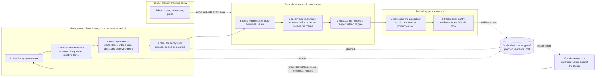

<!-- Copyright (c) 2026 Nokia -->
<!-- SPDX-License-Identifier: BSD-3-Clause -->

<!-- field: executive_summary -->
## Executive summary

This repository specifies and implements AI-native Scrum: a
project-agnostic version of Scrum in which the administrative work is done
by scripts and AI agents instead of people. scrum-master, the Go binary built here,
is that implementation, and the skills are thin scripts over it. Most of
what Scrum asks people to do outside the work itself is moving facts:
saying what was done yesterday, updating the board, estimating, reporting
status, chasing dependencies. The tracker already holds those facts. Here,
scripts read and write them, the scrum master's administrative role is
automated away, and people spend their Scrum time only on the judgments the
tracker cannot make. The process has one unit of work, the issue, and one
source of truth, the tracker. Everything else is a label on an issue, a
comment on an issue, a link between issues, or a tag on a repository.

The process works by levels and by evidence. A system has subsystems and
subsystems have components; each level has one owner (the technical
program manager, a Product Owner, the Developers), and the test subsystem
has its own owner, the Scrum Master. Every repository at every level
carries the same docs/ corpus, and repositories reference each other by
URLs pinned to release tags. A Sprint Goal is met when the tests its
acceptance criteria name pass in the environment it names, not when its
issues close; the environments run from a developer's machine through dev,
staging, and a production proof of concept to the customer's R&D
environments, and the test software ships with every release.

The process is organized in three planes. The management plane sets intent
on a three-week cadence: the next release at each level and the Sprint Goals
each level pushes to the level below. The control plane holds the rules
that decide how an issue moves: the label schema, the state machine,
routing, admission, scheduling, and escalation, as versioned policy files.
The data plane is the work itself, flowing continuously: issues popped by
the people who pull them, built in worktrees, closed by the reviewed merge
that delivers them, and handed downstream when an artifact is released.

Work runs in two loops. The inner loop (specify an issue, implement it
in its own worktree, merge, release) is the same for every role
and every kind of work, because every issue states its own requirements
and acceptance criteria. Audits are recurring issues the same loop works
on a schedule; track-goals is the audit that follows pinned references,
collects test evidence, and closes Sprint Goals on it. The outer loops are
the Scrum events, specified here as SRDs: each reads the tracker, asks
people only what the tracker cannot know, and pushes issues for the inner
loop.

<!-- field: problem -->
## Problem

Traditional Scrum is heavy in administrative work. The daily standup is
mostly people reciting status the tracker already records. Backlog
grooming and estimation ceremonies take hours to produce numbers nobody
checks. Status reports are written from memory on Friday and contradict
the board. Dependencies between teams live in a program manager's
spreadsheet, maintained by hand and always behind. Most of this work is
not judgment; it is moving facts between people and the tracker.

Whole roles exist largely to do it. The scrum master's day is facilitating
meetings, updating boards, counting points, and chasing blockers. The
program manager's is reconciling plans across teams. The product owner
spends more time managing the task list than deciding what the product
should be. A large share of each is administrative, and AI can do it: a
script can read what happened, compute what is late or blocked or ready,
route work created by one team's output to the team that owes something,
and draft the report, asking a person only for what the tracker cannot
know.

What remains for people is intent and judgment: what to build next, why
the work mattered, whether a result is good enough to depend on, what to
change about the process. Today those few judgments are buried in the
administrative load, and the load grows with every team and every
cross-team dependency. When agents also write most of the code, the
administrative work is what is left between people and delivery.

<!-- field: vision_model_diagram -->
## Vision model diagram

One three-week release cycle, numbered in order. Intent enters as
Sprint Goals, the work flows as issues, and evidence returns to each
Sprint Goal's ledger, which the sprint review judges.

<!-- field: what_this_does -->
## What this does

Planning follows the agile hierarchy, each level a document the corpus
gate checks (srd034, srd045). A theme names a strategic area and an
initiative a multi-team outcome for several quarters, the program's
Product Goal, both written by the technical program manager in the system
repository. An epic is a large body of work under an initiative, an
optional feature a capability inside it, and a user story the unit of
value a team finishes in one sprint, each with one parent and owned by a
Product Owner. Each sprint, every team receives a Sprint Goal, an issue
citing the initiative items it serves, and its Sprint Planning lists on
it the stories it selected, ranked and sized in story points. A story's
acceptance criteria name the test and the environment that prove them,
and cite the SRD requirement items they satisfy by URL pinned to a release
tag. An idea or an incident between sprints enters as a filed issue. So
the chain from intent to evidence is initiative, epic, story, issue,
merge, release, and evidence on the Sprint Goal's ledger.

The process defines, and scrum-master and the skills implement:

- Levels and owners: system (technical program manager), subsystem
  (Product Owner), component (Developers), and the test subsystem (Scrum
  Master), each with its own SRDs, road-map, and definition of done, in
  the same corpus shape in every repository.
- A three-week period ending in a release at each level. plan
  picks the requirements the release proves; tasks pushes one
  Sprint Goal per downstream owner, citing the requirements by URL pinned
  to the release tag and naming the environment where it counts.
- The Sprint Goal as ledger: planned, evidence, and met events from
  which the Sprint Goal's state is replayed. track-goals posts evidence and
  closes a Sprint Goal when its tests pass in its environment.
- An environment chain (local, dev, staging, production PoC, customer
  R&D), each an SRD in the test subsystem, with promotion as CI/CD
  automation and handoff to a customer as a human approval.
- A label schema on five axes (plane, type, kind, component, state) that
  makes every issue self-describing, and a state machine over it that says
  which transitions are legal and who may make them.
- An inner loop every role uses for every kind of work: specify,
  implement, the reviewed merge, and scrum-master release. Audits
  (regression tests, contract checks, the sprint and stakeholder updates)
  are recurring issues worked by the same loop.
- Outer-loop skills for the decisions people make together: plan a
  release, push Sprint Goals downstream, run the Daily Scrum, review the
  Increment against evidence, and change the rules at the Retrospective.
  Each pushes issues in the issue body's work format.
- Pull, not assignment: open, unassigned, admitted issues are ready, and
  only a person's own implement assigns anything.
- Handoff: when an artifact is released, a script creates the downstream
  work its consumers owe, in their repositories; consumers are the
  repositories that cite the artifact's interface by pinned URL and the
  recurring issues that subscribe to it. When a downstream issue closes,
  a comment notifies the upstream issue.
- Dependencies as links: an issue waits on another issue or on a release
  tag, and the morning script reports what became unblocked.
- Tracking issues with a task list of member issues, closed when the last
  member closes; issues decomposed into tasks for one worktree and one
  merge.
- A dashboard rendered from the tracker into the program's repository,
  never edited, and a weekly roll-up that asks the lead only about what
  cuts across reports.
- Artifact kinds, so an experiment, a report, a review, and a decision
  travel the same loop as code, each with its own finishing condition.

<!-- field: why_we_build_this -->
## Why we build this

Scrum's events and roles are worth keeping; its administrative load is
not. The aim is a process that keeps the events (planning, the daily
scrum, review, retrospective) and the judgments they exist for, and moves
everything else to scripts. Two principles do that.

Facts are fetched, judgment is asked. The tracker records what happened.
Scripts read it and never ask a person for it. Skills ask a person only
what the tracker cannot know: why the work mattered, what is blocked, what
comes next, whether an Increment is acceptable.

Pull, never push. Nobody assigns work to anyone. Producers release, the
script routes, consumers pull. That is what lets the scrum master's
administrative role be a set of scripts each person runs instead of a
person, and what lets a program keep flowing on its last configuration
when the management plane is absent.

The project agnosticism is deliberate. A process that encodes one
project's components cannot be audited, reused, or handed to the next
program. Everything a project supplies is an input the control plane
reads.

The design is aligned with the [AI-Native SDLC
Playbook](https://claude.com/resources/articles/the-ai-native-sdlc-playbook):
both make a committed specification the source of truth, have an agent
build from it, put a person at the gates, and run delivery as a loop
rather than a line. The playbook's intent.md is this process's initiative,
and its spec.md is a story with the SRD it cites. This process adds what the playbook
leaves to one team in one repository: levels, contracts between teams,
and done as evidence in a named environment. The comparison, and the
practices taken from the playbook, are in
[docs/guides/sdlc-playbook.md](guides/sdlc-playbook.md).

<!-- field: success_criteria -->
## Success criteria

- one_command_morning: A person's morning is one command: it shows what closed, what is overdue, what became unblocked, a plan, and the evidence findings on their Sprint Goals.
- downstream_issues_unwritten: A released artifact creates every downstream issue its consumers owe without anyone writing one, and never creates the same one twice.
- met_only_by_evidence: Every Sprint Goal is met only by passing evidence in its named environment, recorded on its ledger; closing all of its issues without that evidence leaves it open.
- pinned_references_resolve: Every cross-repository reference is pinned to a release tag and resolves; the audit fails otherwise.
- cycle_time_from_ledger: Cycle time from Sprint Goal planned to met, and rework, are read from the ledger for every release; nobody types them.
- generated_dashboard: The program's dashboard is regenerated from the tracker and is never edited by hand; deleting it loses nothing.
- no_person_ranked: No script assigns, ranks, or estimates a person; the only assignment is a person's own implement.
- flows_without_management: A program keeps flowing for a full sprint with no management-plane action, on its last milestone, release, and policy.
- one_unit_of_work: Every object the process uses is reachable from an issue by a label, a comment, a link, or a tag; there is no second unit of work.
- clean_corpus_audit: The corpus audits clean: every SRD in a release, every use-case touchpoint names a requirement group, every acceptance criterion traced by a test.

<!-- field: not -->
## Not

- Assigning people to work. Issues are ready; the person pops.
- Estimating or ranking people. Scripts report cycle time per component, never per person.
- Role-specific agents. Every role runs the same inner loop; the scrum master's administrative work is audits and scripts, and the team view is what they wrote.
- Tracker features beyond issues, labels, comments, links, and milestones: no tracker-native epic objects, no blocking links, no custom fields. Everything maps onto a plain tracker, which is how the beads tracker (srd042) serves it.
- Any one project's content: subsystems, components, environments, repositories, and names are inputs supplied by the consuming program.
- A platform, runtime, or codebase that the process builds. The process is indifferent to what the issues produce.
- Holding status in a program repository. The tracker repository is the source of truth; every other repository holds specifications and work, never status.

<!-- field: canonical_documents -->
## Canonical documents

- docs/ARCHITECTURE.md
- docs/SPECIFICATIONS.md
- docs/road-map.md
- docs/constitutions/design.md
- docs/specs/software-requirements/srd034-initiatives.md
- docs/guides/process.md
- docs/guides/ai-native-sdlc.md
- docs/guides/sdlc-playbook.md
- docs/guides/agile-mapping.md
