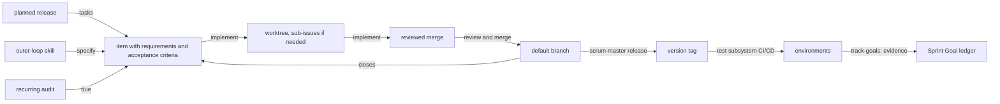

<!-- Copyright (c) 2026 Nokia -->
<!-- SPDX-License-Identifier: BSD-3-Clause -->
# The Inner Loop

This guide describes how one piece of work travels from intent to a merged,
reviewed result. Every role uses this loop, for every kind of work, and the
outer-loop Scrum skills exist to feed it. How releases are planned,
Sprint Goals pushed between levels, evidence collected, and the Increment
reviewed is the subject of
[process.md](process.md); the two layers are separate, and a team could run
this loop under a different management structure.

## The premise

Most of the output is produced by agents. A person states what should exist
and how to tell that it does; an agent builds it; a person reviews the result
before it lands. The loop is built around that split, because its two failure
modes are an agent building the wrong thing from a vague item, and an agent
building a plausible wrong thing that nobody reads before it merges.

Not every item is code. A program of developers and researchers also writes
architecture documents and OpenAPI schemas, changes Terraform and Helm,
runs experiments, writes papers and reports, reviews other people's
artifacts, adapts to new versions of what it depends on, and releases
versions for others. All of it travels the same loop. The item states its
deliverable and the criteria it is checked against, so the loop needs no
variant per kind; the kind label decides who pulls the item and how it is
counted, not how the work runs.

## The loop

Planning and execution are kept in separate context windows on purpose. When
a plan and its diffs share one window, the plan erodes as test output fills
it. The tracker holds the plan, so no window has to.

| Step | Who | Skill | Produces |
|---|---|---|---|
| Make | Developers, from a chosen story | `tasks` | One item per change the story needs, each in the issue body's work format |
| Push | Anyone, or an outer-loop skill on their answer | `specify` | One item with plane, kind, component, Requirements, Acceptance Criteria, Design Decisions, and an estimate, filed unassigned |
| Pop | The person who will do it | `implement` | The item assigned to that person and no one else, a fresh worktree from the default branch, and sub-issues when the item is larger than one pass |
| Work | The assignee, driving an agent | `implement` | Each unit built against its Acceptance Criteria and committed with its requirements; actual size logged against the estimate |
| Gate | Another person, when the policy requires it | approval, then merge | Review against the definition of done |
| Close | The merge | closing lines | The item and its sub-issues closed; cycle time recorded |
| Release | The producer, when others depend on it | `scrum-master release gate`, then `scrum-master release tag` | A version tag behind the release gate, which handoff routes downstream |

## The item is the specification

There is no separate specification document for a piece of work. An item
carries its Requirements, Acceptance Criteria an agent can check, the Design
Decisions already made, and the files it touches. That is the issue body's
work format, and every outer-loop skill pushes items in it. A vague item produces
the wrong result at once, so the product owner's work, split between the
program lead at component interfaces and the Product Owner and Developers
inside a component, is clarity rather than list management. Effort is
estimated in size and review complexity, because typing is no longer the
cost. Where the Design Decisions an item carries come from — the boundary
between design and planning — is
[plan-vs-architecture.md](plan-vs-architecture.md).

## Audits

Some work recurs: regression tests and benchmarks against the default
branch, contract checks at every artifact boundary, the dashboard, the weekly
sprint update, and the stakeholder update. Each is a recurring item worked
by this same loop, on a schedule or when a person triggers it. A run is
popped and worked like any other item; its findings are pushed as new items
rather than written into a report nobody acts on; and `implement`
re-creates the recurring item for the next run. The Daily Scrum shows each
person the findings that landed on their work overnight.

## The definition of done

Whether a merge waits for a person other than its author is the program's
choice. With `require_approval` in its policy, no kind and no size is
exempt, and `scrum-master issue merge` refuses a branch without that person's
approval of its tip; by default review is the team's practice, and an
approval given is recorded on the merge. The reviewer is not checking what the tests check; the
reviewer looks for what passes the tests and is still wrong: a pattern that
will not scale, a security hole, drift from the architecture, a shortcut the
acceptance criteria did not forbid. The issue's Requirements and
Acceptance Criteria are what the reviewer reads the change against.

The rest of the definition of done is the item's own Acceptance Criteria,
and each criterion names the test that proves it and the environment where
that proof counts. A component item is done when its tests pass in the
local environment and its branch merges. A Sprint Goal is done only
when the tests its requirements name pass in the environment it names, on a
recorded pinned set, which track-goals records as evidence; closing the
Sprint Goal's items is not enough. By kind, the criteria usually say:

| Kind | Finished when |
|---|---|
| build, consume | Tests pass; actual size recorded against the estimate |
| experiment | The result and the command that reproduces it are committed |
| research | The document is committed with a Result section |
| review | A response is recorded and the item closes with a verdict |
| handoff | The decision and its reasons are recorded |
| release | The release gate passed and the version tag exists |

A release is the second gate. A merge means the work is done; a release means
others may depend on it. The program's policy declares, for each shared
artifact, the checks a release must pass and the environment each runs in:
its own tests, the contract tests of the repositories that cite it, a
scorecard against the currently released version for artifacts whose
quality tests cannot see, or a peer's reading. Each result is evidence. The
checks live in policy, not in anyone's habit, so they are the same for
everyone, and changing one is a reviewed change to the policy file.

After the tag, the test subsystem promotes the release along the
environment chain: a fresh install in dev, an upgrade on a running system in
staging, the same upgrade in a production proof of concept. Each step runs
only when the previous environment's suites passed, on the trigger the
receiving environment declares. Handoff to a customer's R&D environment is
a person's approval, and the test software ships with the release.

Because agents produce changes faster than people read them, review is
the bottleneck of the loop. The answer is to make review faster, through
small items, clear acceptance criteria, and a stated reviewer focus, never to
make it rarer.

## Measures

Velocity is cycle time from a Sprint Goal planned to met, and from item
filed to branch merged; rework is met Sprint Goals reopened by failing
evidence, items reopened, and merges reverted. All are read from the
ledger and the tracker by component; nobody types them, and nothing is
measured per person.
