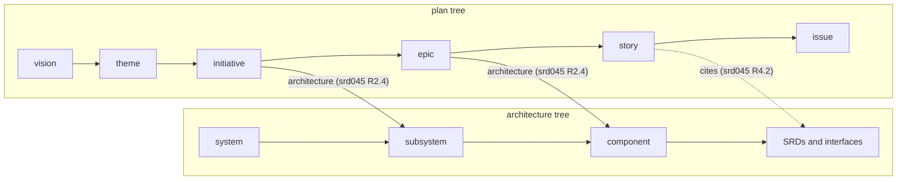
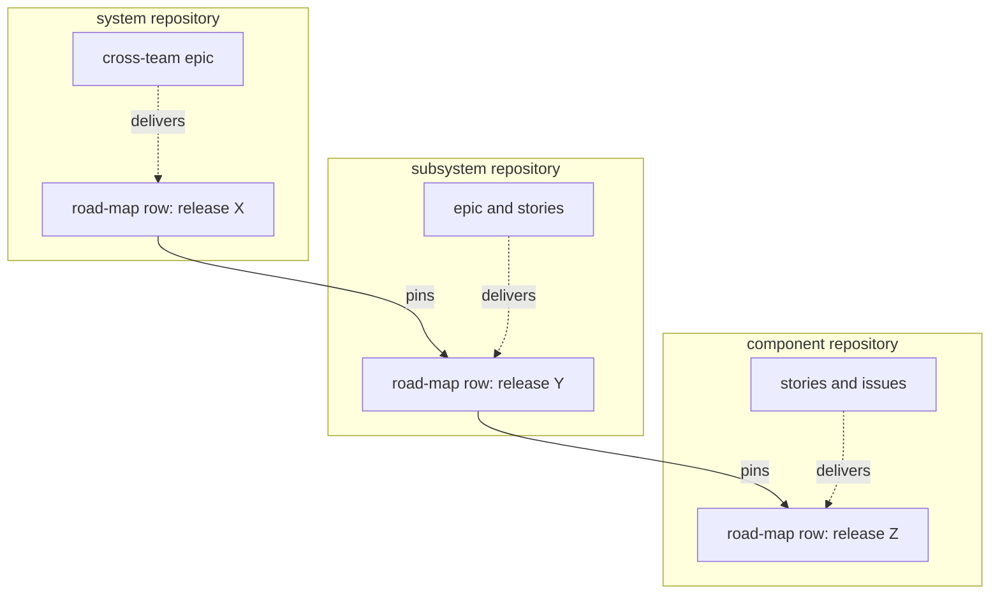
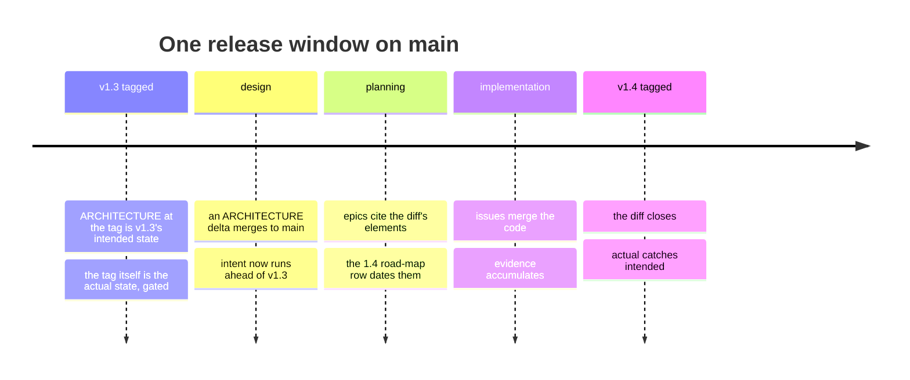
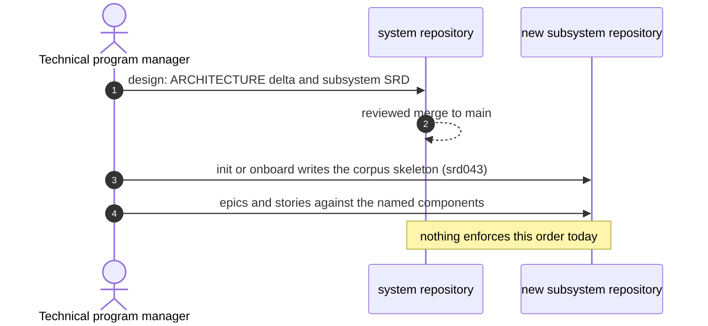

<!-- Copyright (c) 2026 Nokia -->
<!-- SPDX-License-Identifier: BSD-3-Clause -->
# The Plan and the Architecture

The corpus keeps two trees. The planning hierarchy breaks strategy into
work: vision, theme, initiative, epic, feature, story, and the issue that
executes a story ([agile-mapping.md](agile-mapping.md) Table 4). The
architecture names what the system is made of: the system, its subsystems,
their components, and the interfaces between them (design.md D7,
ARCHITECTURE.md). This page states how the two relate. In short: the
architecture declares intended state, release tags hold actual state, and
the plan is the ordered gap between the two. The release is where they
meet. This is the model behind the skills that run the process: plan
writes the road-map (srd031), tasks turns chosen work into issues
(srd022), implement moves the actual state (srd036), and the audit gates
what any of them may merge.

Two kinds of relationship appear below, and conflating them is where the
confusion about "planning versus design" starts. A **structural**
relationship says what contains or cites what, at one moment: parent links
in the plan tree, containment in the architecture, citations from plan to
architecture, the repository boundaries that align the two trees. A
**temporal** relationship says what precedes what: the horizon of each
level, architecture running ahead of code, design before planning before
implementation, intended before actual. Each figure on this page shows one
kind, never both.

Much of the machinery this page describes already exists, and each claim
names its document and item. What does not exist is stated as a gap, in
[the last section](#what-exists-and-what-does-not); every gap is a change
to the design constitution, so this page records candidates, not
decisions.

## Intended and actual state

ARCHITECTURE.md declares what should exist: components, interfaces, flows,
and the decisions behind them. A release tag holds what does exist: the
tree as of that commit, proven by the release gate (srd015 R1,
[ai-native-sdlc.md](ai-native-sdlc.md)). The distance between the two is
the plan. Each hierarchy document is a transition: it names the intended
elements it moves toward actual, and it is done when a tagged release
ships them.

One level down, the same relation already has its full mechanism. An SRD
is the intended contract of one skill or subsystem; a story's cites
context item lists the SRD requirement items its criteria prove (srd045
R4.2), and an evidence event records each criterion passing in its named
environment (srd006, srd019). Which requirements are actual is therefore
derived, item by item. At the architecture level there is no counterpart:
ARCHITECTURE.md records progress only in its hand-written
implementation_status field (design.md architecture.required_fields).
The SRD level computes its intended-to-actual transition; the architecture
level narrates it.

## The structural map

### Two trees and the citation edge

The plan tree and the architecture tree run in parallel, one level apart.
A theme spans the system; an initiative is a multi-team outcome across
subsystems (srd034 R1); an epic is a body of work inside a subsystem,
typically against named components; a story proves SRD items, the contract
at component and interface grain. The only citation edge that exists today
is the lowest one: story to SRD item (srd045 R4.2). The edges above it —
an epic naming the components it changes, an initiative naming the
subsystems it crosses — are implicit in prose and in each document's
problem field, which no gate can check.

**Figure 1** The two trees and the citation edges between them.

*Each plan level sits one step above the architecture grain it moves: an
initiative crosses subsystems, an epic changes components, a story proves
SRD items. Each edge is a checked context item: a story's cites, and on
every level the architecture item naming the components it moves
(GH-55); whether the plan covers the ARCHITECTURE diff is the audit this
page still records as a gap. The feature level (optional, between epic and story) is
omitted for space.*

### The direction of reference

Links run from the ephemeral to the stable, as everywhere in the corpus:
an issue cites its story, a story its SRD items, a use case its
requirements. Plan documents therefore cite architecture elements and
target releases; ARCHITECTURE.md never lists the epics or releases that
touch it, for the same reason an SRD never lists the stories that prove
it. The architecture-side view — per element: intended since when, in
transition through which open epics, actual as of which tag — is derived
from the citations, the way the dashboard and the forecasts are
regenerated rather than kept (srd045 R7, srd018 R11). A derived view is
never typed twice and never drifts from its sources.

### Repositories

The repository boundary is an architecture boundary. The system
repository holds the vision, themes, initiatives, the program road-map,
cross-team epics, and the system ARCHITECTURE whose components are the
subsystems, each declared by a subsystem SRD with its owner and its
implementation_targets (design.md subsystem_srd). Each subsystem
repository holds its own ARCHITECTURE naming its components, and the plan
levels it owns: its epics, features, and stories
([agile-mapping.md](agile-mapping.md) Table 4). A repository holds plan
documents only for work inside its own architecture, so the parent's
ARCHITECTURE must name a subsystem before any plan document can exist in
that subsystem's repository.

Across those boundaries, the program plan travels as a pinned set. The
system road-map row for release X lists the subsystem releases it will
pin; each subsystem's row lists its component releases; and Requires:
ARTIFACT >= VERSION lines make the blocking automatic — an issue waits
until the tag it needs exists (srd007 R2.1, R3.1). The Increment is the
pinned set of releases promoted together (srd008, srd015).

**Figure 2** The planned pinned set across repositories.

*Release X in the system repository plans to pin subsystem release Y,
which plans to pin component release Z; Requires lines block each
consumer until the tag below it exists (srd007 R2.1). The plan documents
attached to each row are the work that accomplishes it. Containment and
citation only — the order in which the releases happen is Figure 3's
subject.*

## The temporal map

### The release, three ways

A release is three things at once. It is a dated plan milestone: a
road-map row on the three-week cadence, carrying its tag and milestone
under release.publication and, in the system repository, the initiative
items it proves as deliverables (srd034 R3.1). It is an intended-state
snapshot: the elements that should exist as of it. And once tagged it is
an actual-state snapshot: the tag exists only behind the release gate
(srd015 R1), so the tag is the proof, in rolled-up, pinned form. The
road-map's release statuses — specified, implemented, released, and the
corpus gate refuses any other (srd045 R8.2) — are the intended-to-actual
transition at release granularity. The road-map is a sequence of dated
intended states; the plan is the ordered gap between the last tag and the
planned rows; the epics are the work attached to each gap.

What already enters that chain per release: initiative items
(deliverables), SRDs and use cases (the road-map's lists), and other
repositories' releases (Requires lines and the pinned set). What does not
enter it: architecture elements. That is the one new thing this page
proposes to observe, not the chain itself.

### Git versions intent

ARCHITECTURE.md as of tag X is the intended state of release X. Git
already versions the file, so no release number is hand-stamped into it,
and no per-release architecture copy exists. Three consequences follow.
Design is merging an ARCHITECTURE change to main ahead of its
implementation, so main's ARCHITECTURE runs ahead of the last tag — by a
release or two, not by years; intent beyond the near horizon stays in
initiatives and themes at coarser grain. The near-term plan is the diff
between ARCHITECTURE on main and at the last tag: exactly what the next
release or two must deliver. And epics cite the elements of that diff
plus the road-map release they target, so the per-release intended view
is derived from road-map rows and epic citations, regenerated like the
dashboard, never typed twice. Dates live only in road-map rows and their
milestones, because forecasts are regenerated, never baselined (srd018
R11): a slip is one plan write (srd031), not an edit to N architecture
documents.

**Figure 3** Intended and actual along main, one release window.

*Between two tags, main's ARCHITECTURE leads the code: a design merge
opens a diff against the last tag, planning attaches that diff to a dated
road-map row, implementation closes it, and the next tag makes the
intended state actual. The main-versus-last-tag ARCHITECTURE diff is the
near-term plan at every point in the window.*

### Horizons and precedence

Each plan level has its horizon — themes months to years, initiatives
several quarters, epics several sprints, stories one sprint, issues days
([agile-mapping.md](agile-mapping.md) Table 4) — and the architecture
precedes the plan one level down. The system ARCHITECTURE names a
subsystem before that subsystem's repository holds an epic; a subsystem's
ARCHITECTURE names a component before stories are written against it.
"Create a subsystem" therefore crosses the boundary in a fixed order:
first the design merge in the system repository (the ARCHITECTURE delta
and the subsystem SRD), then init or onboard bootstraps the new
repository with its corpus skeleton (srd043), then the epics and stories
in it. Nothing enforces that order today; a repository created first
simply has no architecture element to cite.

**Figure 4** The order in which a subsystem comes to exist.

*A subsystem exists in the system ARCHITECTURE before it exists as a
repository, and as a repository before it holds plan documents. The
sequence is a precedence rule, not a script: today each step is an
ordinary reviewed merge, and no gate refuses a plan document whose
subsystem the parent has not named.*

## Three activities, told apart by output

Design, planning, and implementation separate cleanly by what each one
changes, and a conversation with an agent is in exactly one of the three
modes at a time, identified by its output.

Table 1: The three activities.

| Activity | Changes | Output | Lands where |
|---|---|---|---|
| Design | Intended state | An ARCHITECTURE or engineering delta plus Design Decisions, merged ahead of implementation; no skill owns it today | The system repository for subsystem boundaries; the team's repository for component shape |
| Planning | The sequence of the gap | Hierarchy documents citing intended elements and target releases; road-map rows (plan, srd031; tasks, srd022; draft, srd046) | The repository that owns the level ([agile-mapping.md](agile-mapping.md) Table 4) |
| Implementation | Actual state | Merges, evidence, and release tags (implement, srd036; scrum-master release, srd015) | The component's repository |

The tell for a mode switch is the output. When epic-writing starts
inventing component boundaries, it has switched to design, and the sign
is that it wants to produce an ARCHITECTURE change. Today the corpus
names no design activity. "Plan" is overloaded three ways: srd031's plan
is Scrum scheduling, Spec Kit's /plan writes ARCHITECTURE.md and Design
Decisions ([spec-kit.md](spec-kit.md) Table 1), and an agent plans its
own session. Design Decisions arrive on items "already made"
([ai-native-sdlc.md](ai-native-sdlc.md)) — the activity that makes them
has no name, no skill, and no gate. Where they were made is therefore
invisible to the tracker.

## The SRD and the story

Three documents at the bottom of the chain are easy to conflate, and
each has one job. The SRD is the durable contract — the AI-native PRD: it
outlives any sprint and changes only through the audit gate. The story is
a scheduled, ranked claim that named SRD items will be proven, sized to
one sprint and ordered by the Product Owner (srd045 R5.1). The issue in
the work format is what the agent builds from — the AI-native user story:
"the item is the specification"
([ai-native-sdlc.md](ai-native-sdlc.md)). Contract, claim, and build
instruction; intended state, transition, and execution.

## What a reader sees

The model above lives in git: intent is the main-versus-last-tag
ARCHITECTURE diff, actual state is tags, transitions are epic citations.
A person browsing ARCHITECTURE.md on main sees none of it — the file
reads the same whether an element shipped two releases ago or merged as
intent yesterday. The corpus's answer to this kind of problem is already
established: views are regenerated from sources, never kept by hand, as
the dashboard, the burn-up, and the forecasts are (srd018 R11, srd045
R7). Progress, intent, and status reach readers through generated
surfaces, not through more hand-written status fields.

The surfaces split by level. The road-map is the human summary of intent
and dates: one page where a reader sees what each coming release delivers
and its status — specified, implemented, released (srd045 R8.2). Dates
and deliverables live there precisely so a reader never consults git. At
the work level, the sprint-end summaries (design.md sprint_end_summary)
and the dashboard already communicate progress. At the architecture
level there is only implementation_status, hand-written — the field most
likely to rot, because nothing regenerates it and nothing refuses it when
it is stale. The generated equivalent is the derived architecture-side
view this page already names: per element, actual as of which tag, in
transition through which open epics toward which release, or intended
with no coverage yet. The point is that it exists for readers, rendered
where they look — a generated section or sibling page beside
ARCHITECTURE.md, or a report — not only as an audit input. And the folder
READMEs that init and onboard write (srd043) are the orientation layer: a
first-time reader learns there that intent is versioned by release and
where the status view is.

Agents are readers too. The skills run as declarative-agents profiles
(design.md D14), and an agent planning or implementing needs this model —
which elements are intended, which exist, which mode it is in — as much
as a person does. Today a guide reaches an agent only through the corpus
index: SPECIFICATIONS.md lists every guide, and the READMEs init and
onboard write orient whoever reads a program repository first (srd043).
No profile names a guide as context, and nothing routes one into an
agent's window; that is an observation about the same gap, not a surface
to invent here.

The test is a reader who knows no git. They can answer "what exists, what
is being built and when does it land, what is planned beyond that" from
rendered documents alone. A question that requires running git diff or
listing tags marks a missing surface.

## What exists and what does not

The corpus already carries most of this page. Release statuses are the
intended-to-actual transition at release grain (srd045 R8.2). A system
release names the initiative items it proves, its tag, and its milestone
(srd034 R3.1). Requires lines and the pinned set carry the plan across
repositories (srd007 R2.1, srd008, srd015). Stories compute the
transition at SRD grain (srd045 R4.2, srd006). Every hierarchy document
may cite the components it moves in its architecture context item, a
bare id checked against this repository's ARCHITECTURE or a URL pinned
to another's (srd045 R2.4, R6.2, design.md D15; GH-55). The four
candidates below followed: the coverage and drift audits (GH-56), the
status view (GH-57), and the design mode (GH-58).

- **A coverage audit.** Every element in the main-versus-last-tag
  ARCHITECTURE diff is cited by at least one agreed plan document. An
  uncovered element is declared intent no one has planned to build — a
  hole in the plan.
- **A drift audit.** Nothing ships in a release that no intended element
  covers. Drift means a stale ARCHITECTURE or an agent building off the
  map; either way the intended state stopped being the source of truth.
  The last release is the road map's latest released release, by its
  tag, read through the repository's textconv filter: a corpus tag that
  only publishes a plan is no release. A change is covered by an agreed
  document added or changed since that release, and a component whose
  status field begins Deferred is intent kept on purpose, never warned
  (GH-88, GH-99).
- **A generated architecture status view.** The reader-facing surface of
  [What a reader sees](#what-a-reader-sees): per element, actual as of
  which tag, in transition through which epics, or intended with no
  coverage, regenerated like the dashboard. It depends on the
  architecture context item (srd045 R2.4), and it would replace the hand-written
  implementation_status field rather than sit beside it.
- **A design mode** now exists as the design skill (srd047, GH-58): an
  activity whose only output is intended-state deltas, ARCHITECTURE and
  engineering changes with their Design Decisions, filed as an issue and
  merged ahead of implementation — in the system repository for subsystem
  boundaries, where the technical program manager merges, and in the
  team's repository for component shape, where the Product Owner and the
  Developers do. Planning that would need an element ARCHITECTURE lacks
  stops with "this needs a design decision" instead of inventing it.
