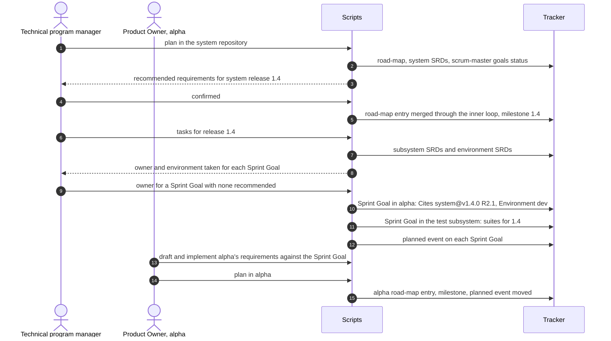
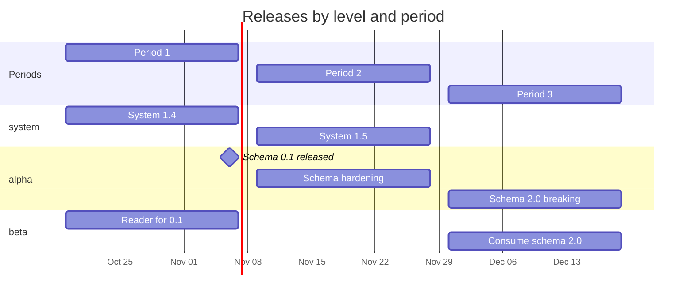
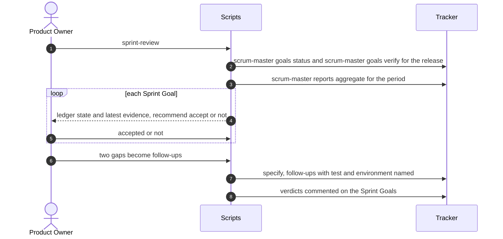
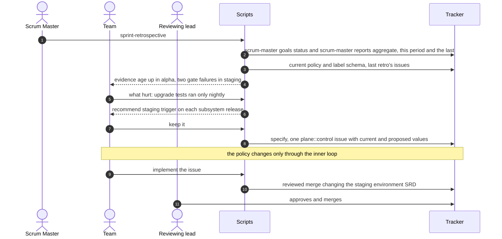
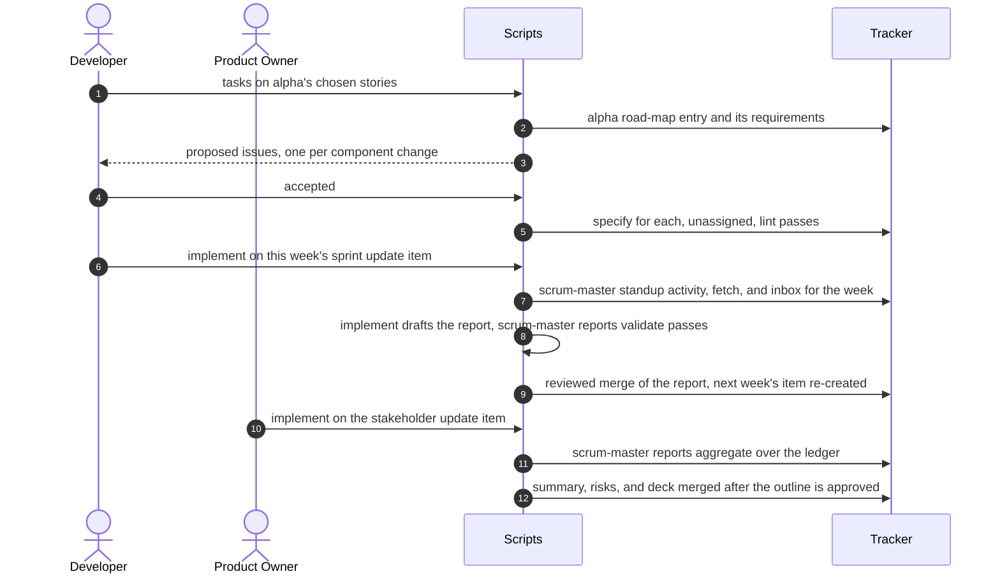
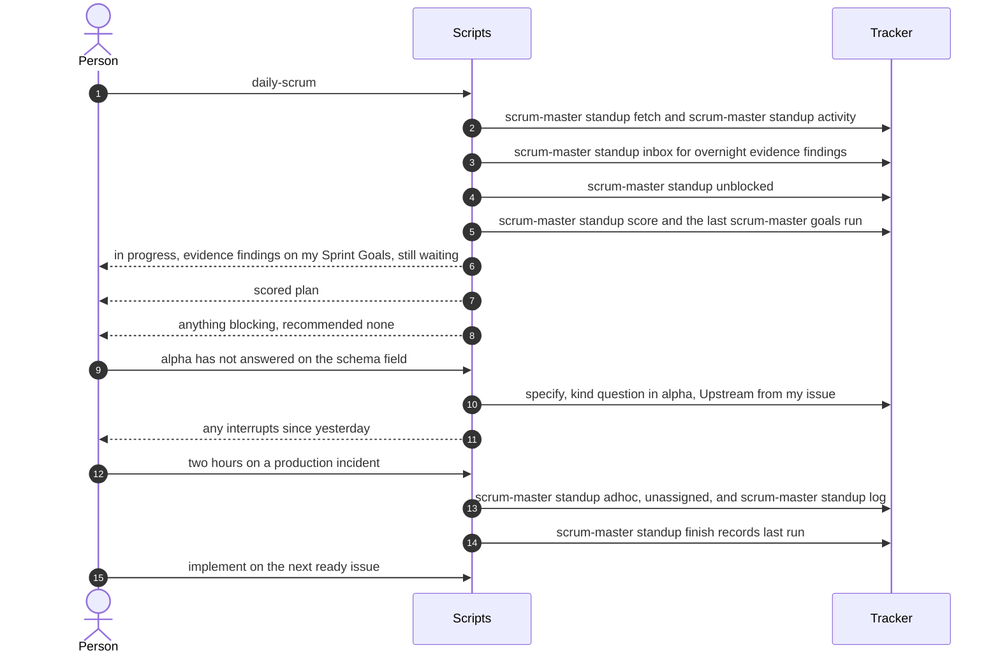
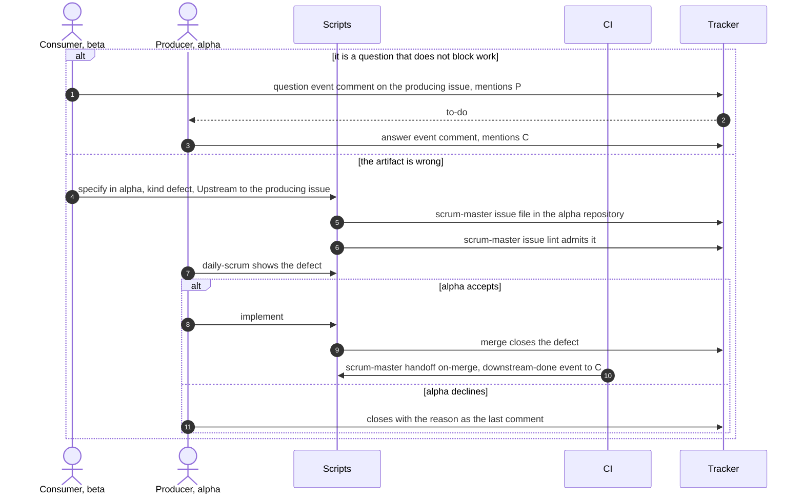

<!-- Copyright (c) 2026 Nokia -->
<!-- SPDX-License-Identifier: BSD-3-Clause -->
# The Process

This page shows how the process runs, in Scrum's own terms. Three figures
come first. The first two use the same grid. The rows are the roles of a
program in which several Scrum teams build one product: on top, the
technical program manager, who owns the program's architecture and roadmap,
and below it Scrum's three accountabilities in each team (the Product Owner,
the Scrum Master, the Developers). The Scrum Guide describes one team and
has no program role; it appears as soon as several teams depend on each
other, as in Nexus, where a program-level Sprint Goal is broken into each
team's Sprint Goal. The columns are Scrum's three time horizons: the product
horizon of the Product Goal and roadmap, the Sprint with its planning,
review, and retrospective, and the daily work of the Daily Scrum and building
the Increment. Compare the first two figures block by block.

The first figure is Scrum as most programs practise it. Each block lists
what people do there. The technical program manager keeps the architecture
and roadmap in documents and spreadsheets and reconciles each team's plan by
hand; the Product Owner writes human-facing stories and manages the task
list; the Scrum Master runs standups, removes roadblocks, and calculates
velocity; the Developers estimate in story points and spend most of their
time typing code.

![Scrum today: people do the work. A grid of the roles of a multi-team Scrum program (technical program manager, Product Owner, Scrum Master, Developers) against Scrum's three time horizons, each block listing what people do. Technical program manager: keep the architecture and roadmap in documents and spreadsheets, manage multi-team spreadsheets and dependencies, manage integration schedules, reconcile each team's plan by hand, chase teams when a dependency slips. Product Owner: rewrite the roadmap into the team's backlog, manage the task list, write human-facing stories, answer questions about them. Scrum Master: set up the workflow and board, calculate velocity points, run standups, remove roadblocks. Developers: tell other teams about releases, estimate in story points, spend about 80 percent of their time typing syntax, reading documentation, and writing boilerplate, merge to staging when unit tests pass. Legend: the Sprint Backlog is human tasks in story points; the Definition of Done is code written, unit tests passed, merged to staging; sprints are two-week iterations; velocity is points per sprint.](../../figures/scrum-today.png)

The second figure is AI-native Scrum, on the same grid, with each block split
into what people do and what agents do. Intent is pushed down: the technical
program manager sets the architecture and declares each system release, and
pushes each subsystem its Sprint Goals with the environment where they count.
Work is pulled: each subsystem's Product Owner writes the requirements that
satisfy its Sprint Goals with an agent, Developers turn the plan into issues,
and people pop issues for themselves. Agents never plan a sprint on
their own; they bring the facts into planning and record the plan people
agree. Specifications are written by people and agents together, the agent
drafting and the person correcting and approving, as YAML requirements,
OpenAPI schemas, or Markdown. The Scrum Master stops doing the administration
and owns the developer environment, the agents, and the pipelines that do
it. Velocity keeps its usual meaning, the story points of epic backlog items
drawn down per period, read from the ledger (srd045); cycle time from
Sprint Goal planned to met, and rework, which the figure's legend lists, are
the flow measures read beside it. [agile-mapping.md](agile-mapping.md)
maps every element of the Scrum Guide to its counterpart here.

![AI-native Scrum: people decide, agents do the administration and the code. The same grid with the columns product horizon, release period, and daily work; each block shows what people do above what agents do. Technical program manager, owning the system: people set the architecture, write the system SRDs and the subsystem SRDs that name each owner and component, declare which subsystem satisfies which system requirement, plan the next system release and push Sprint Goals citing pinned requirements with their environment, approve handoff to customer R&D environments, resolve breakages, and answer cross-team questions; agents hold the system requirements and contracts at pinned tags, bring what track-goals recorded into release planning, record the release and post planned events, draft the program report from the ledger, run boundary testing, and follow pinned references across repositories. Product Owner, owning a subsystem: people write requirements that satisfy each Sprint Goal with every criterion naming its test and environment, plan the subsystem release, push Sprint Goals to downstream component repositories, judge the Increment against recorded evidence, and clarify intent; agents propose requirements, draft specifications, flag vague specs, show each Sprint Goal's ledger and evidence at the Review, and keep the dashboard current. Scrum Master, owning the test subsystem: people specify the environments and their promotion triggers as SRDs, agree the working agreement and Definition of Done, choose improvements, keep the suites honest, and keep CI and promotion from becoming the bottleneck; agents apply the agreement, prepare agendas, bring cycle time, rework, and evidence age to the Retrospective, file agreed changes, and promote pinned sets along the environment chain posting each result as evidence. Developers, owning the components: people approve releases, turn the chosen stories into issues with tasks, estimate review complexity, write prompt files, give agents context, and review pull requests; agents announce releases to citing repositories, propose tasks, size items, lint each issue for a named test and environment, generate the code, auto-test, and merge after human review recording local test evidence. Legend: the Definition of Done is human review plus the named tests passing in the named environment, recorded as evidence; a period is three weeks ending in a release; velocity is cycle time from Sprint Goal planned to met, plus rework.](../../figures/scrum-ai-native.png)

The specification behind the process is organized in three planes rather
than by role, and the third figure regroups the second figure's content by
plane. The management plane holds intent, what to build and why; the
technical program manager and the Product Owner act in it, and it changes
once per sprint. The control plane holds the rules work moves by: the
architecture and contracts, the working agreement, the Definition of Done,
and the developer environment; the technical program manager and the Scrum
Master act in it, and it changes only through reviewed edits. The data plane
is the work; the Developers act in it, continuously. Each item for people
names the role that does it.

![AI-native Scrum by plane: intent, rules, and work. The three planes as rows against the three time horizons, each block split into people, labelled by role, and agents, regrouping the second figure's items. Management: the TPM writes system and subsystem SRDs, plans system releases and pushes Sprint Goals with pinned citations, and approves customer handoff; the PO writes requirements against Sprint Goals, plans subsystem releases, pushes Sprint Goals downstream, and judges the Increment against evidence; agents bring track-goals' records into planning, post planned events, draft reports from the ledger and specifications, and show evidence at the Review. Control: the TPM sets the architecture and resolves breakages; the SM specifies environments and promotion triggers, agrees the Definition of Done, keeps the suites honest, and keeps CI and promotion fast; agents hold pinned shared context, follow pinned references, apply the agreement, bring evidence age to the Retrospective, and promote pinned sets posting evidence. Data: Developers approve releases, turn the chosen stories into issues with tasks, estimate review complexity, give agents context, and review pull requests; agents announce releases to citing repositories, lint issues for test and environment, generate the code, auto-test, and merge after human review.](../../figures/scrum-planes.png)

All three figures read in two directions. Down a column, intent and working rules
flow from the technical program manager, the Product Owner, and the Scrum
Master to the Developers, and facts
about the work flow back up through the issue tracker. Across a row, each
horizon sets the frame for the faster one to its right, and the faster one
produces the evidence the slower one judges.

## Levels, loops, and evidence

Traditional Scrum spends much of its time on administration: reciting status
at the standup, updating the board, estimating, writing reports, and keeping
a spreadsheet of who waits on whom. Most of that is moving facts between
people and the tracker, which already holds them. Two rules move it to
scripts. Facts are fetched, judgment is asked: a script never asks a person
for something the tracker records, and a skill asks only what it cannot read.
Pull, never push: nobody assigns work to anyone, and the only way an item
gets an assignee is that person's own `implement`.

A program has levels, and each level has one owner and the same corpus: a
docs/ directory with SRDs and a road-map, checked by the same audit.

| Level | Owner | Writes | Done when |
|---|---|---|---|
| System | Technical program manager | System SRDs, interface YAMLs, and the subsystem SRDs in the system repository | System tests pass on the pinned set in the final environment |
| Subsystem | Product Owner | Requirements that satisfy its Sprint Goals; the local road-map | Its requirements' tests pass in the environment each Sprint Goal names |
| Component | Developers | Issues from chosen stories with tasks, then code through specify and implement | Component tests pass; the branch is reviewed and merged |
| Test subsystem | Scrum Master | SRDs for environments, pipelines, and suites | Known-good sets pass and known-bad sets fail |

Layout is declared, not inferred. A subsystem SRD in the system repository
lists its components by repository URL and path, and each environment is an
SRD in the test-subsystem repository. Repositories reference each other only
by URLs pinned to a release tag, so a citation never drifts under its reader.

![The levels of the extended system and who owns each. The extended system holds the system, owned by the technical program manager, and beside it the test subsystem, owned by the Scrum Master. The system holds the system SRDs, which say what the system must do and which subsystem satisfies each requirement; the interface YAMLs, the contracts subsystems implement and contract tests are generated from; and two subsystems, each owned by a Product Owner, done when their requirements pass in the named environment. Each subsystem holds components named by repository URL and path, such as group/ingest and group/platform:/cmd/agent, written by Developers and done when component tests pass and a person approved the merge. Subsystems implement the interfaces, and their requirements cite system requirements pinned to a release tag. The test subsystem holds the environments (local, dev, staging, production PoC, customer R&D, each an SRD with its trigger and suites) and the suites and pipelines (regression, contract, install, and upgrade tests, shipped with the release); it generates contract tests from the interfaces and runs every pinned set of the system, posting the evidence.](../../figures/levels.png)

Done is evidence. Every acceptance criterion names the test that proves it
and the environment where that proof counts. The environments form one
chain: local for component tests; dev, a fresh install, for subsystem and
system tests; staging, one subsystem upgraded on a running system; a
production proof of concept on the same upgrade path; then the customer's
R&D environments. Promotion along the chain is CI/CD in the test subsystem,
triggered as each environment's SRD declares; handoff to a customer is a
person's approval, and the test software ships with the release so the
customer can run it.

![The environment chain, from a developer's machine to a customer's R&D. Our environments run left to right: local proves the component works with unit and component tests, run by the Developer and before every merge; dev proves subsystems and the system work on a fresh install with install, contract, and regression tests on each component release; staging proves one subsystem's release upgrades a running system, on each subsystem release or nightly; production PoC proves the same upgrade path holds under real use, once a pinned set is green in staging. A green production PoC goes to a handoff approval, where a person decides the pinned set, its evidence, and its test software are ready. Handoff crosses into customer R&D: their dev environment proves it installs and upgrades on their infrastructure and data, using our suites run by them, with evidence coming back to our Sprint Goal; their staging and production are beyond the handoff.](../../figures/environments.png)

What is left for people runs in two loops. The inner loop is how any one
item gets done, the same for every role and every kind of work: `tasks`
turns a chosen story into issues, `specify` files an issue with its
Requirements, Acceptance Criteria, and Design Decisions, `implement`
takes it into a worktree and builds it, a merge, approved by
another person when the policy requires it, closes it, and `scrum-master release tag` tags a release once its
gate passed. The inner
loop is described in [ai-native-sdlc.md](ai-native-sdlc.md). Audits are
recurring items the same loop works on a schedule; `track-goals` is the
audit that follows pinned references every night, posts the evidence it
finds on each Sprint Goal, and closes a Sprint Goal when its evidence passes.

The outer loops are the Scrum events, the workflows where people decide
together.

| Skill | Who | Reads | Asks | Pushes or posts |
|---|---|---|---|---|
| `plan` | Technical program manager (system), Product Owner (subsystem), before each three-week period | Road-map, SRDs, open Sprint Goals, track-goals status | Which requirements the next release proves | The road-map release entry, its milestone, planned events |
| `tasks` | Technical program manager, or a Product Owner with downstream repositories | The planned release, subsystem and environment SRDs | Which owner satisfies a Sprint Goal, only where none is recommended | Sprint Goals citing pinned requirement URLs, one to the test subsystem |
| `daily-scrum` | Each Developer, daily | In-progress issues, overnight evidence findings, waiting issues | Blockers, interrupts | Blocker and interrupt issues |
| `sprint-review` | Product Owner, end of each period | Each Sprint Goal's ledger and evidence | Is the Increment accepted? | Follow-up issues |
| `sprint-retrospective` | Scrum Master with the team, end of each period | Audit metrics, current policy | Which improvements? | Policy-change issues |

The road-map is the plan, tags are releases, and each Sprint Goal is a
ledger: comment events record when it was planned, every piece of evidence
(requirement, environment, version, result), and when it was met. Anyone
can replay those events to the Sprint Goal's state. A rule change from the
retrospective is a control-plane issue like any other, popped, worked
against `policy.md`, and merged by a reviewed merge.

When a component releases a version of a shared artifact, the release
creates the work its consumers owe. Consumers are the repositories that cite
the artifact's interface by pinned URL and the recurring issues that
subscribe to it. An issue that cannot finish until something else does
names it, as the issue whose output it consumes, the release it needs, or
the pinned requirement it cites, and track-goals keeps a waiting flag true
to those links.

## Who directs whom

Two more figures show the same change as relationships rather than as blocks.
In Scrum today, every relationship between the four roles runs through
meetings and hand-kept artifacts: the roadmap documents and dependency
spreadsheets the technical program manager reconciles, the stories and task
list the Product Owner manages, the board and velocity numbers the Scrum
Master maintains, and the status the Developers report. Nothing moves unless
a person moves it.

![Scrum today: how the roles relate. The four roles connect through one hub of meetings and hand-kept artifacts: standups, planning, reviews, the Scrum of Scrums, roadmap documents, dependency spreadsheets, the board, and status reports. The technical program manager hands roadmap slices to the Product Owner in documents, keeps the spreadsheets, and chases teams when a dependency slips. The Product Owner writes stories and answers the Developers' questions. The Scrum Master updates the board, calculates velocity, runs standups, and removes roadblocks. The Developers report status, update tickets, log time, and type the code by hand.](../../figures/scrum-roles-today.png)

In AI-native Scrum the hub is the issue tracker and the program's versioned
files, and the moving is done by the two loops. There are no role-specific
agents: every role starts the outer-loop skills that belong to it, and every
role works items through the same inner loop, so a Product Owner refining a
specification and a Developer changing a Helm chart run the same specify,
implement, and merge. Agents never direct other agents, never assign work to
anyone but the person who popped it, never approve anything, and never
change a rule except by a merge a person approves; the
[agents semantic model](../specs/semantic-models/agents.md) states these
rules. The one relationship between roles that is not mediated by the
tracker is the push of intent: the owner of each level pushes Sprint Goals to the level below,
citing the requirements they must satisfy at a release tag.

![One three-week release cycle, read left to right, one row per role. Technical program manager: 1, plan picks the system requirements the next release will hold; 2, tasks pushes one Sprint Goal per subsystem and to the test subsystem, citing requirements pinned to the tag. Product Owner: 3, writes requirements with an agent through specify and implement, each criterion naming its test and environment; 4, plan places them in a release of the subsystem's road-map and posts planned on the Sprint Goal. Developers: 5, tasks turns the planned release into issues; 6, specify and implement build each issue, a person approves every merge, and local tests are the first evidence; 7, scrum-master release tags the component release. Scrum Master: 8, promotion by CI/CD installs the pinned set in dev, upgrades it in staging and production PoC, and runs the suites; 9, track-goals nightly posts evidence on each Sprint Goal. The Sprint Goal is the ledger of planned, evidence, and met; 10, sprint-review judges the Increment against it at the end of the period, and unmet Sprint Goals move to the next release.](../../figures/release-cycle.png)

The rest of this page takes one column at a time, from the slowest to the
fastest, and one accountability at a time within it, with a diagram wherever
one makes the flow clearer. The rows correspond to the three planes of the
specification (management, control, data), named in each heading for readers
going on to the SRDs. The inner loop is described in
[ai-native-sdlc.md](ai-native-sdlc.md), the requirements in
`docs/specs/software-requirements/`, why this process exists alongside
Spec Kit in [spec-kit.md](spec-kit.md), and how it compares with the
AI-native SDLC playbook in [sdlc-playbook.md](sdlc-playbook.md).

Three conventions hold in every diagram on this page. An arrow from a person
to the scripts is a skill the person runs; it asks only what the tracker
cannot know. An arrow from the scripts to the tracker is a scrum-master subcommand; it
fetches facts or writes changes and never asks anything. And the only arrow
that assigns work is `implement`, run by the person taking it. Subsystems
are placeholders: alpha produces a shared schema, beta consumes it, and both
belong to one system.

## Product horizon: releases and Sprint Goals

### Technical program manager and Product Owner (management plane): plan and push

Each repository's road-map is its intent over several releases: the
releases, the requirements each proves, and their status. Before each
three-week period, the owner of a level runs `plan` to choose the
requirements the next release proves, and `tasks` to push one
Sprint Goal to each owner below. At system level that is the technical
program manager pushing to each subsystem's Product Owner and to the Scrum
Master; at subsystem level it is a Product Owner pushing to downstream
component repositories when there are any.





Nothing stores status in the road-map. Whether a Sprint Goal was met is in
its ledger, written by track-goals from evidence.

### Scrum Master (control plane): the working agreement and the test subsystem

Some rules almost never change, and every script depends on them: the five
label axes and their values, the issue state machine with the one actor
allowed to fire each transition, the vocabulary of comment events including
the ledger events, and the lines scripts read from an issue's description
(`Upstream:`, `Requires:`, `Cites:`, `Environment:`, the `Downstream`
section, and the work format's Requirements, Acceptance Criteria, and
Design Decisions). They are specified in srd001, srd006, srd007, and the label
schema, and they change only through a reviewed control-plane issue.

The Scrum Master also owns the test subsystem as a product: one environment
SRD per stage of the chain, with its owner, the trigger that promotes a
pinned set into it, and the suites that run there; and the suites
themselves, each with known-good and known-bad sets that test the tests.

### Developers (data plane): releases and long work

Some data outlives any period. A shared artifact's releases form a version
history that consumers depend on through `Requires:` and pinned `Cites:`
lines. Each consumer can keep one recurring issue per artifact it depends
on, closed and reopened on every run with the run logged. These are the slow
objects of the data plane.

## Period: three weeks

### Product Owner (management plane): requirements and review

Inside the period, the Product Owner writes the subsystem's requirements
against its Sprint Goals as ordinary issues built by implement on the
subsystem's docs/, each acceptance criterion naming its test and
environment. At the end, the Product Owner judges the Increment against the
evidence track-goals recorded; met is a fact, acceptance is a judgment.

**Sprint review.**



### Scrum Master (control plane): the retrospective

The retrospective is the one Scrum event that changes how the program works.
It starts from the period's audit metrics and ends in at most three
control-plane issues, each proposing a change to a policy entry with the
metric that motivated it. The issues are worked by the inner loop like any
other, and the next period runs on the merged result.



### Developers (data plane): tasks and audits

Developers turn each chosen story into issues with
`tasks`, each in the issue body's work format. Through the period, the weekly
sprint update and the stakeholder update are audits: recurring issues worked
by the inner loop from scrum-master standup and scrum-master reports output, which reads the
ledger rather than counting closed issues.



## Daily work: the Daily Scrum, building the Increment, and evidence

### Product Owner (management plane): observe only

The management plane does not act at this time scale. The dashboard is
regenerated from the ledger by `scrum-master goals status`; the owner reads it and
answers the cross-level questions it raises, and never takes, moves,
labels, or closes an issue. This is what lets execution run headless on the
last release and policy when nobody manages it.

### Scrum Master (control plane): promotion and the evidence audit

At this time scale the control plane is automation applying the rules
continuously: `scrum-master issue lint` admits new issues or marks them
needs-triage, the test subsystem's pipelines promote pinned sets along the
environment chain, and track-goals follows pinned references, posts
evidence, closes met Sprint Goals, and keeps every issue's waiting flag true
to its links.

The figure below expands step 8 of the release cycle into the systems that
carry it out. Where the release cycle shows people and agents, this one
shows GitLab, its pipelines, Argo CD, and the GKE clusters on GCP.

![Step 8, promotion: the systems that carry a release along the environment chain. Four rows, one per system: GitLab (repositories and registry), GitLab CI/CD (pipelines), Argo CD (one per cluster), and GKE on GCP (one project and cluster per environment). 8.1, the tag scrum-master release puts on a component repository starts the tag pipeline from infrastructure/gitlab, which lints, tests, and builds the image; 8.2, it pushes the image to the container registry; 8.3, it triggers the promotion pipeline in test/environments with the project and tag; 8.4, the promotion pipeline commits the new version into the dev pinned set in the environments repository, which holds one pinned set per environment; 8.5, Argo CD in dev syncs to that pinned set; 8.6, it installs the system fresh on the dev cluster; when Argo CD reports healthy, the suite pipeline runs, 8.7, the install, contract, and regression suites against dev and keeps the results as test reports; 8.8, when they are green, the staging pinned set is committed and Argo CD upgrades the running system in staging, where upgrade and regression suites run; 8.9, when staging is green, the production PoC pinned set is committed and Argo CD upgrades it, where upgrade and smoke suites run. The test reports feed step 9, track-goals, which posts evidence on the Sprint Goal nightly. Fill shows ownership: the product scrum owns the component repository; the test scrum owns the environments repository, its pipelines, and the Argo CD applications; the infrastructure scrum owns the GitLab structure, the CI templates, the registry, the GCP projects, the GKE clusters, and Argo CD itself. Clusters pull images from the registry; handoff to customer R&D is outside the figure and needs a person's approval.](../../figures/promotion-systems.png)

```mermaid
sequenceDiagram
    autonumber
    actor P as Producer, alpha
    participant CI as Test subsystem CI
    participant S as Scripts
    participant T as Tracker

    P->>T: alpha 0.2.0 tagged by scrum-master release tag
    CI->>CI: dev: fresh install of system 1.4 pinned set with alpha 0.2.0
    CI->>CI: subsystem and system suites pass in dev
    CI->>CI: staging trigger is nightly: upgrade alpha on the running system
    CI->>CI: upgrade suites pass in staging
    CI->>S: scrum-master goals run, nightly
    S->>T: resolve Cites system@v1.4.0 R2.1 on alpha's Sprint Goal
    S->>T: evidence event: R2.1, test ingest_fresh, dev, set 1.4-a0.2, pass
    S->>T: met event; Sprint Goal closed
    opt a criterion names no environment
        S-->>T: finding on the dashboard; audit fails until fixed
    end
    Note over CI,T: production PoC follows on its own trigger; customer R&D waits for a person's approval
```

### Developers (data plane): the issue loop

The work itself, continuous. Each person starts the day with the daily
scrum, pops an issue, builds it in a worktree with implement, and lands it
through review. Releases create what consumers owe; consumers learn of it
the next morning; information travels upstream as comments and work as
issues.

**Daily scrum.**



**An issue's life.**

```mermaid
sequenceDiagram
    autonumber
    actor A as Author
    actor P as Person
    actor R as Reviewer
    participant S as Scripts
    participant T as Tracker

    A->>S: specify
    S-->>A: plane, kind, component, requirements, criteria with test and environment
    S->>T: scrum-master issue file, unassigned
    S->>T: scrum-master issue lint
    alt a label, section, test, or environment is missing
        T-->>A: needs-triage with the failures listed
        A->>T: fixes the issue
        S->>T: scrum-master issue lint clears needs-triage
    end
    Note over T: open, unassigned, admitted: the issue is ready
    P->>S: implement
    S->>T: assignee is P
    S->>S: fresh worktree from the default branch, marker commit
    P->>S: build
    loop each issue of the story
        S->>S: build against its acceptance criteria, commit with its requirements
    end
    S->>T: reviewed merge; local tests run and are recorded as evidence
    R->>T: reviews what tests cannot see, approves
    R->>T: merges
    T-->>T: issue and sub-issues closed by the merge
```

**Release and handoff.**

```mermaid
sequenceDiagram
    autonumber
    actor P as Producer, alpha
    actor C as Consumer, beta
    participant S as Scripts
    participant CI as CI
    participant T as Tracker

    P->>S: the release issue's steps
    S->>T: scrum-master release next
    S-->>P: recommend major, the diff removes a field beta reads
    P->>S: major
    S->>T: scrum-master release gate runs the declared checks in their environments
    T-->>P: unit tests pass locally, contract tests pass in dev, peer read pending
    Note over P,T: the run stops until another person approves the release issue
    S->>T: gate again, all evidence passes; scrum-master release tag 2.0.0, breaking
    T->>CI: new tag
    CI->>S: scrum-master handoff on-release
    S->>T: beta cites schema@v1.4.0, so beta is a consumer
    S->>T: consume issue in beta with Requires 2.0.0 and Cites schema@v2.0.0
    CI->>S: scrum-master goals run
    C->>S: daily-scrum shows the consume issue
    C->>S: implement
    S->>T: merge closes it; the citation moves to v2.0.0 by reviewed merge
    CI->>S: scrum-master handoff on-merge
    S->>T: downstream-done event on the release issue, mentions P
```

**Upstream signal.**


